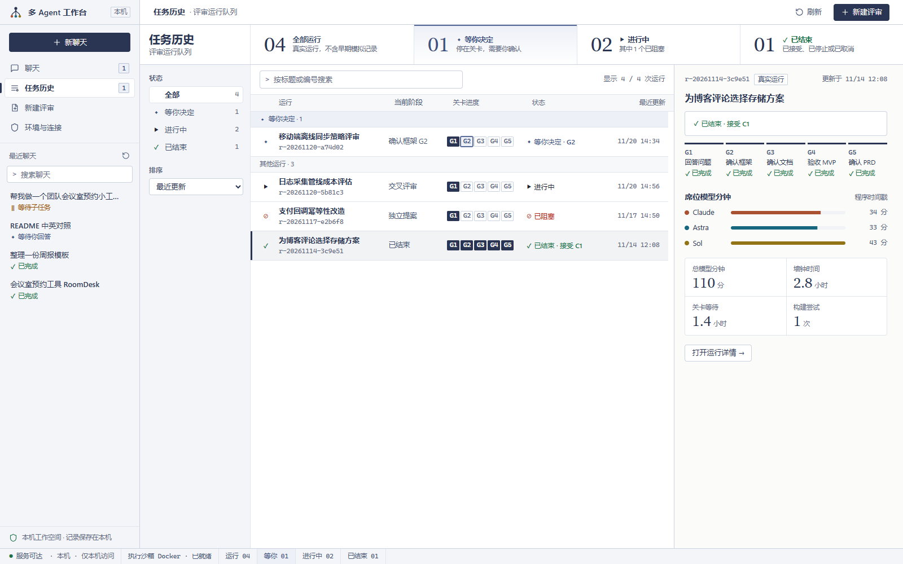
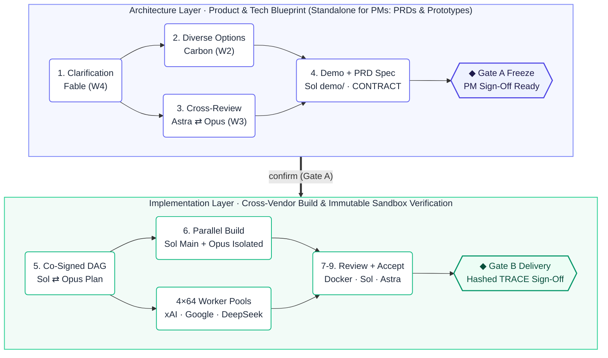

<div align="center">

<picture>
  <source media="(prefers-color-scheme: dark)" srcset="docs/images/apexcluster-logo-dark.svg" />
  <source media="(prefers-color-scheme: light)" srcset="docs/images/apexcluster-logo.svg" />
  
</picture>

# ApexCluster

### The Apex Multi-Vendor Product & Engineering Cluster
**Local Subscriptions (Zero Extra API Fees) · Partial-Model Per-Task Teams & Custom Lead Agent · PRD-Ready Architecture · Immutable Sandboxes**

<p>
  <a href="https://johnson-durui.github.io/ApexCluster/"><strong>▶ Live Demo</strong></a> ·
  <a href="README.md">中文</a> ·
  <a href="README.en.md"><strong>English</strong></a> ·
  <a href="ARCHITECTURE.md">Architecture</a> ·
  <a href="docs/CONFIGURATION.md">Configuration</a> ·
  <a href="docs/EXTENDING.md">Extending</a> ·
  <a href="SECURITY.md">Security</a>
</p>

<p>
  <a href="https://johnson-durui.github.io/ApexCluster/"></a>
  = 22.12" />
  
  
  
  
  
  
  
</p>

</div>

---

**ApexCluster** (Multi-Agent Workbench) is not another prompt-chaining script where one LLM talks to itself and declares `"LGTM — all tests pass"`. It is a **local-first, adversarial, multi-vendor product & software engineering cluster** built for complex, end-to-end delivery.

Orchestrating **Anthropic, OpenAI, Google, xAI, and DeepSeek** across **5 weighted flagship seats (`4 → 3 → 2`)** and **4 parallel worker pools (up to `64` concurrent workers each)** — paired with the real-time **Command Deck** observability web UI — it combines **zero-API-fee subscription reuse, partial-model team flexibility**, and **flagship two-layer delivery**:

- **Local Subscription Ready (Zero Extra API Fees & Anti-Billing Guard)**: The Dual-Model Review Workbench (`/api/runs`, `npm run probe`) works **out of the box with your existing Claude Code (Claude Pro/Max) and Codex CLI (ChatGPT Plus/Pro) sign-ins** — zero API keys required. Adapters explicitly strip `ANTHROPIC_API_KEY`, `OPENAI_API_KEY`, `CODEX_API_KEY`, and all `*_API_KEY` env vars before spawning CLIs and verify subscription login status so you never get surprise API charges. Command Deck also supports proof-gated local CLI chats (`driverMode: "cli"`, incl. optional Cursor Agent CLI / Grok), alongside BYOK API mode for the full 5-lab pipeline.
- **Partial-Model Ready (Per-Task Multi-Agent Teams & Custom Lead Agent)**: Don't have all 5 labs? Start cleanly with 1, 2, or any subset of verified API models or local CLI logins — startup never blocks and unavailable models are surfaced transparently with **zero silent downgrade**. Before launching a task in Command Deck (or via `POST /api/chats` `team`), **freely designate ANY available model or CLI agent as the Lead Agent**, select `0–16` collaborators (`collaborator` / `writer` / `reviewer`), and explicitly grant dispatch authority (`proactive` / `explicit` / `none`, `allowLeadWrite`, `requireAcceptanceReview`) — frozen per session and enforced by code.
- **PRD-Ready Architecture Layer (Tailor-Made for Product Managers)**: Start from a rough business idea and let multiple frontier labs clarify requirements, explore competing options, cross-review risks, and build a runnable prototype (`demo/`) — outputting a complete, frozen **`PRD.md`, technical architecture spec, dev guide, and measurable acceptance contract (`CONTRACT.json`)** at **Gate A**. Works even with a single API provider (`single-provider` preset); PMs can sign off right at Gate A or confirm to enter implementation.
- **Cross-Vendor Implementation & Sandbox Verification**: Past Gate A, opposing provider families co-sign the milestone plan, build in isolation, cross-review inside immutable Docker sandboxes, run independent acceptance, and emit a cryptographically linked `TRACE`.

> **Core Invariant**: **Model prose cannot promote the pipeline.** Only durable program state, validated `CONTRACT.json` schemas, SHA-256 artifact hashes, structured command receipts, cross-window read acknowledgements, and final `TRACE` evidence can advance delivery.

### ⭐ Star History

<p align="center">
  <picture>
    <source media="(prefers-color-scheme: dark)" srcset="docs/images/star-surge-dark.svg" />
    <source media="(prefers-color-scheme: light)" srcset="docs/images/star-surge.svg" />
    
  </picture>
</p>

<p align="center"><sub>0 → 149 stars in under 4 days after the first star, peaking at +28 in a single hour · <a href="https://star-history.com/#Johnson-Durui/ApexCluster&Date">Live chart →</a></sub></p>

---

## Online Demo

[](https://johnson-durui.github.io/ApexCluster/)

**[▶ Open the Live Online Demo →](https://johnson-durui.github.io/ApexCluster/)** &nbsp;|&nbsp; **[Try the Delivered RoomDesk App →](https://johnson-durui.github.io/ApexCluster/demo-project/)**

The online demo runs this repository's real **Command Deck** web interface on preset, scripted data: **no backend, no API keys, and zero model calls** (interface is in Chinese). Click **▶ 播放完整演示** (play the full demo) in the status bar to watch a team meeting-room booking app (**RoomDesk**) go from raw requirement to verified delivery:

1. **Architecture cluster (PRD & prototype)**: multiple seats clarify requirements, propose competing options, cross-review risks, and produce the PRD, architecture spec, and runnable demo while the live task map animates every dispatch and return along fibres.
2. **Gate A human checkpoint**: the run stops and lists the frozen contract & deliverables for your sign-off (auto-confirms after 20 s without input).
3. **Cross-vendor build & independent acceptance**: mixed-provider implementation, cross-review, integration, and independent acceptance.
4. **Gate B delivery**: preview or download the PRD, architecture spec, source code, test report, and complete project archive.

The delivered [RoomDesk sample app](https://johnson-durui.github.io/ApexCluster/demo-project/) opens directly in your browser (floor filtering, conflict detection, iCal export, and 30 automated tests). Task history, new review, and environment pages are browsable too.

Run the same demo locally:

```sh
npm ci --prefix web
npm --prefix web run dev:demo
```

Then open <http://localhost:5180>. The demo source lives in [`web/demo/`](web/demo/); `npm --prefix web run build:demo` builds the static bundle into `web/dist-demo/`.

---

## Screenshots

All screenshots are captured from the real Command Deck frontend running on the online demo's preset data:

| | |
|---|---|
| <br>**Live task map**: the lead splits the work; dispatches and returns between seats animate along fibres | <br>**Human gates**: the run stops where your decision is needed and lists the gate's deliverables |
| <br>**Deliverables**: each file names the seat that produced it and can be safely previewed or downloaded | <br>**Architecture view**: full-screen topology, reasoning effort and context usage |
| <br>**Decision pipeline**: architecture, gate A, implementation, acceptance, gate B, done | <br>**Task history**: review runs with state, pending decisions and metrics |
| <br>**Review runs**: candidate comparison and decision | <br>**Environment**: seat models, keys, execution sandbox and services |


<sub>The RoomDesk meeting-room booking app delivered by the demo pipeline: floor filter, conflict detection and iCal export, with 30 automated tests.</sub>

---

## Why ApexCluster?

Conventional multi-agent demos collapse on real software engineering: long horizons erase original specs, same-family models rubber-stamp each other's bugs, runtimes silently swap to weaker models, and shell commands execute on the host with exposed credentials. ApexCluster enforces **hard programmatic invariants** at every boundary:

| Dimension | Typical Multi-Agent Toys | ApexCluster |
| :--- | :--- | :--- |
| **Access & Subscription Cost** | Forces expensive multi-vendor API keys, or leaks env vars causing accidental API billing | **Local Subscriptions + BYOK w/ Anti-Billing Guard**: Out-of-the-box local **Claude Code & Codex CLI** subscriptions for reviews (zero API keys), actively scrubbing all `*_API_KEY` env vars before spawning CLIs; API mode supports partial-provider verification & custom OpenAI-compatible endpoints |
| **Partial Models & Custom Lead** | Breaks if one model is missing, or hardcodes a single fixed lead with unguarded delegation | **Partial-Model Ready & Custom Lead Agent**: Starts cleanly with 1 or any subset of models; designate **any available API model or local CLI seat as Lead Agent** per task with explicit dispatch (`proactive` / `explicit` / `none`) and write/review boundaries frozen in code |
| **Review Independence** | Single model or same family grades its own homework | **Mandatory Cross-Vendor Separation**: Implementation author and reviewer must belong to different model families (`Sol` [OpenAI] ⇄ `Opus` [Anthropic]); `Astra` runs independent acceptance on a frozen copy |
| **Source of Truth** | LLM text claims *"Done / Tests passed"* | **Program-Owned State Machine**: Every transition binds `CONTRACT.json`, SHA-256 snapshot/artifact hashes, structured `argv` command receipts, and post-adoption `TRACE` |
| **Model & Image Integrity** | Silent fallbacks, aliases, mutable `:latest` tags | **Zero Silent Downgrade**: Exact registry model IDs, zero-inference listing proofs (`models:verify`), and immutable local `sha256:` Docker image digests |
| **Long-Horizon Context** | Lossy LLM summarization drops specs & errors | **Lossless Window Rotation**: Tracks real physical limits and actual token usage, rotating before hard thresholds with mechanically assembled reference-preserving handoff packets |
| **Authority & Concurrency** | Flat chaotic loops where any agent edits anything | **Weighted Delegation (`4 → 3 → 2 → 1`)**: Agents can only dispatch to strictly lower weights; `Sol` is the sole main-workspace writer; 4 worker pools scale up to `64` concurrent workers each |
| **Execution & Secret Safety** | Host shell strings with leaked API keys | **Hard Trust Boundaries**: Offline non-root Docker sandboxes by default (plus WSL `bwrap` / Windows MXC); env-only API keys never enter configs, logs, browser payloads, or containers |

---

## Two-Layer Pipeline Architecture

> **Built for Product Managers too (Standalone Architecture Layer)**: The Architecture Layer works out of the box as a multi-vendor **PRD & prototyping studio**. Feed it a rough product idea and the cluster clarifies edge cases, weighs alternative designs, cross-reviews feasibility across labs, builds a clickable `demo/` prototype, and delivers a frozen **`PRD.md` + `ARCHITECTURE.md` + `DEV_GUIDE.md` + `CONTRACT.json`** at **Gate A** — making it an ideal fit for PM workflows (PRDs, spec reviews, trade-off analysis, and stakeholder prototypes) even when you stop at Gate A, or seamless end-to-end delivery when you confirm into implementation.



---

## Flagship Cluster Roster

Permissions belong strictly to the **seat and phase**, never to a model string. When `delegationWeight` is configured, every agent may only dispatch work to targets with a **strictly lower weight**.

### 5 Flagship Leadership & Engineering Seats

| Seat | Weight | Default Flagship Model | Provider Family | Effort | Role & Enforced Authority |
| :--- | :---: | :--- | :--- | :---: | :--- |
| **`claude` (Lead)** | `4` | `claude-fable-5-2` | Anthropic | `max` | Sole user interface, clarification, owns the single shared proposal & final delivery; delegates to all seats; no direct workspace writes |
| **`astra` (Secondary)** | `3` | `gpt-6.2-astra` | OpenAI | `max` | Feasibility analysis, risk correction, parallel architecture critique, and **cross-family independent acceptance** (`acceptance`, `exec`) |
| **`opus` (CrossRef)** | `3` | `claude-opus-5-5` | Anthropic | `max` / `xhigh` | Architecture cross-review, milestone DAG co-signing, **isolated candidate implementation** (`writeIsolated`, `exec`), and cross-vendor review |
| **`carbon` (Ideator)** | `2` | `gemini-4-carbon` | Google | `high` | Generates diverse architectural directions, applicability bounds, and risks without adjudication authority |
| **`sol` (Builder)** | `2` | `gpt-6.2-sol` | OpenAI | `max` | **Sole writer & integrator for the main workspace** (`writeMain`, `integrate`, `exec`); builds `demo/` and integrates verified candidates |

### 4 High-Concurrency Worker Pools (Weight `1`)

| Pool | Default Model | Provider Family | Max Concurrency | Active Layers | Specialty |
| :--- | :--- | :--- | :---: | :---: | :--- |
| **`grok`** | `grok-4.7` | xAI | `64` | Architecture + Implementation | Fast, bounded engineering subtasks and isolated edits |
| **`hydrogen`** | `gemini-4-hydrogen` | Google | `64` | Architecture + Implementation | Massive parallel workers, long-context analysis, and verification subtasks |
| **`deepseek`** | `deepseek-v4-pro` | DeepSeek | `64` | Implementation | Implementation-layer code analysis and cost-efficient engineering subtasks |
| **`mini`** | Parent-matched (`claude-haiku-5-5` / `gpt-6-luna` / `gemini-4-hydrogen`) | Adaptive | `64` | Architecture | Low-cost fast subtasks matched to the parent seat's provider |

> **No Need for All 5 Labs to Start**: The flagship roster above is the full ceiling, not a minimum prerequisite. If you rely on local CLI subscriptions or only have 1–2 API models today, use the **Local Subscriptions** and **Per-Task Custom Team & Lead Agent** workflows below — or select the bundled `single-provider` preset (in UI or CLI) to run the full Architecture Layer through Gate A with a single provider key. See [Configuration](docs/CONFIGURATION.md#rosters-and-presets).

---

## Local Subscriptions & Flexible Per-Task Teams (Partial-Model Ready)

### 1. Local Subscription vs API Access Matrix (Zero Extra API Fees)

ApexCluster cleanly separates **local-subscription CLI drivers** from **BYOK API key drivers** — no browser cookie scraping, no silent cross-mode fallback:

| Surface / Subsystem | Auth Mode | Supported Providers / Agents | Out-of-the-Box Local Subscription (Zero API Key)? | Anti-Billing Safeguards & Honest Scope |
| :--- | :--- | :--- | :---: | :--- |
| **Dual-Model Review Workbench**<br>(`/api/runs` · `npm run probe` · Web *New Review*) | Local Subscription CLI | **Claude Code** (Claude Pro/Max)<br>**Codex CLI** (ChatGPT Plus/Pro)<br>Optional **Cursor Agent CLI** (Grok) | **✅ Yes (OOTB)**<br>(Claude Code + Codex CLI) | Actively strips `ANTHROPIC_API_KEY`, `ANTHROPIC_AUTH_TOKEN`, `OPENAI_API_KEY`, `CODEX_API_KEY`, `CURSOR_API_KEY`, and all `*_API_KEY` env vars before spawning CLIs; `npm run probe` checks `claude auth status` & `codex login status` and warns if API billing is active. Cursor CLI requires H7 capability records |
| **Command Deck Chat CLI Mode**<br>(`driverMode: "cli"`) | Local Subscription CLI | `claude` (Claude Code), `astra` / `sol` (Codex CLI), `grok` (Cursor Agent CLI) | **🔒 Proof-Gated**<br>(Zero API Key, Fail-Closed) | Dynamic host tools + **per-task custom Lead Agent across any qualified CLI seat** (`cliRoster`, no longer locked to Claude); requires local `capabilities/models.json` proofs + Windows Job supervisor isolation (plus WSL2 `bwrap` for Cursor chat) |
| **Command Deck Chat API Mode**<br>(`driverMode: "api"`, default) | BYOK API Keys | Anthropic · OpenAI · Google Gemini · xAI · DeepSeek + custom/local OpenAI-compatible endpoints | API keys via `.env` | Verify only the providers you own (`npm run models:verify -- --provider <p>`); supports loopback `127.0.0.1` / `localhost` endpoints via `config/models.registry.local.json`; full per-task custom team & Lead Agent configurator |
| **v1 Two-Layer Flagship Pipeline**<br>(`npm run pipeline` · Web *Pipeline*) | BYOK API Keys only | Same 5 labs (`single-provider` up to **Gate A**; multi-family for full delivery) | API mode only | **Honest boundary**: v1 Two-Layer Pipeline requires API mode today; Google Gemini and DeepSeek are API-key only; no hybrid CLI+API mixing inside a single chat and zero silent downgrade |

### 2. Partial-Model Per-Task Teams & Custom Lead Agent Dispatch

Missing some frontier models? Startup **never blocks on absent keys or proofs**, unavailable options remain visibly labeled with exact reasons, and you can compose a team from whichever models you actually have:

| What You Have Today | Ready-to-Use Mode | Behavior (Zero Silent Downgrade) |
| :--- | :--- | :--- |
| **Local Claude Code / Codex CLI logins** | Dual-Model Reviews (OOTB) + CLI Chat Custom Teams (proof-gated) | Zero API keys; CLI chat lets you designate `claude`, `astra`, `sol`, or `grok` as **Lead Agent** and dispatch other qualified CLI seats |
| **1 API model** (or 1 provider family) | Custom Team (enable `allowLeadWrite` solo) + `single-provider` Architecture Pipeline | Select `single-provider` in the Command Deck UI or CLI to run the full Architecture Layer through **Gate A** (`PRD.md`, architecture spec, runnable demo) with an explicit Gate-A scope notice |
| **Any 2+ available models** | Command Deck Custom Multi-Agent Team (Custom Lead + Collaborators + Reviewer) | E.g. assign `gpt-6.2-astra` as Lead to orchestrate `gpt-6.2-sol` (`writer`) and `claude-opus-5-5` (`reviewer`) without configuring the other 3 labs |
| **All 5 frontier API keys** | Full `flagship` Two-Layer Pipeline + 4×64 Worker Pools | Full cross-vendor implementation, isolated builds, independent acceptance, and hashed `TRACE` |

Before starting a chat in Command Deck, open the composer's **Custom Team (`自定义协作团队`)** popover (`CollabPopover`) — or pass `team` to `POST /api/chats`:

- **Freely Designate ANY Lead Agent (`leadModel`)**: Pick any verified registered model (with reasoning effort) in API mode, or any qualified local CLI seat (`claude`, `astra`, `sol`, `grok`) in CLI mode.
- **Explicit Lead Dispatch Authority (`delegation`)**:
  - `proactive`: Lead autonomously decomposes work and dispatches authorized collaborators;
  - `explicit`: Lead dispatches collaborators only on demand;
  - `none`: Lead executes solo with delegation disabled.
- **Granular Write & Acceptance Controls**: Toggle `allowLeadWrite` (grant Lead main-workspace write & `exec` authority) and `requireAcceptanceReview` (require an independent `reviewer` sign-off before completion).
- **Select 0–16 Collaborators (`members`)**: Assign per-member roles — `collaborator` (read-only analysis/synthesis), `writer` (main-workspace or isolated-copy implementation & `exec`), or `reviewer` (read-only snapshot independent verification & acceptance). Unavailable models fail closed with HTTP `503` and exact reasons.
- **Frozen Per Session & Program-Enforced (`FrozenChatTeam`)**: Validated teams are synthesized and frozen onto the chat (`apiRoster` or `cliRoster`); `agent_submit` binds strictly to the team's authorized frozen members and fails closed with HTTP `503` if a frozen member later goes offline mid-session — never silently dropping it (while default non-pipeline chats automatically prune offline seats/pools from `agent_submit` / `worker_submit` / `fanout_submit`), alongside programmatic `delegationWeight`, `can.delegateSeats`, and `WorkspaceGateway` enforcement.

Example (`POST /api/chats` — designating a custom Lead Agent and collaborators with only OpenAI & Anthropic):

```json
{
  "title": "Refactor checkout settlement",
  "workspaceId": "w-my-project",
  "team": {
    "leadModel": "gpt-6.2-astra",
    "leadEffort": "max",
    "delegation": "proactive",
    "allowLeadWrite": false,
    "requireAcceptanceReview": true,
    "members": [
      { "model": "gpt-6.2-sol", "role": "writer", "effort": "max" },
      { "model": "claude-opus-5-5", "role": "reviewer", "effort": "max" }
    ]
  }
}
```

---

## Core Engineering Guarantees

- **Zero Silent Downgrade & Verifiable Model Registry**: `config/models.registry.json` pins exact model IDs, wire protocols, physical context limits, supported reasoning efforts, and pricing. `npm run models:verify` verifies account availability via provider listing endpoints (**zero inference calls**). Missing keys, SDK mismatches, or unsupported efforts fail explicitly instead of silently falling back.
- **Cross-Provider Family Independence**: Implementation authors and code reviewers are programmatically prevented from sharing a provider family. During architecture clustering, `Astra` and `Opus` must demonstrably read and acknowledge each other's paged notes before deterministic aggregation. `TRACE` is emitted post-adoption so generating it never invalidates reviewed source hashes.
- **Lossless Context Rotation & Event-Sourced Recovery**: Each invocation starts in a clean window. The runtime tracks actual usage against verified physical limits (`softTokens`, `hardTokens`, `hardRatio`), rotating windows early with mechanically assembled reference-preserving handoff packets — never letting an LLM summary overwrite original user requirements or undelivered receipts.
- **Hard-Boundary Sandboxing & Immutable Images**: Model-generated commands are structured `argv` arrays (no host shell strings). The default Docker backend runs as non-root with resource limits, offline normal jobs, a separate opt-in `installNetwork` path, named package caches, and an immutable local `sha256:` image digest. WSL `bwrap` and Windows MXC backends are also supported via local capability proofs.
- **Conservative Pre-Request Budget Guardrails**: Before each API call, the scheduler reserves against the most conservative price tier and reconciles against actual normalized usage after response — enforced by `budget.maxUsd` and `budget.maxTokens`.
- **Dual-Track Access (Local Subscriptions w/ Anti-Billing + API Pipeline + Per-Task Teams)**: Reuse locally authenticated **Claude Code** and **Codex CLI** subscriptions out of the box (with `*_API_KEY` env scrubbing), compose per-task custom teams & Lead Agents in the loopback-only (`127.0.0.1`) React 19 Command Deck UI, or run headless JSONL API pipelines.

---

## Quick Start

### 1. Run the Zero-Cost Full Offline Docker Demo (Recommended First Step)

Prerequisites: **Node.js >= 22.12**, **Git**, and a running **Docker** daemon. This runs the entire end-to-end pipeline using scripted providers (**zero live model calls, zero API cost**) while spinning up real isolated Docker containers, executing build & acceptance checks, and cleaning up owned resources:

```sh
git clone https://github.com/Johnson-Durui/ApexCluster.git
cd ApexCluster
npm ci
docker build -t dmw-sandbox:local docker/sandbox
npm run demo:offline
```

On success, the final line prints `PASS`.

---

### 2. Use Your Existing Local Subscriptions (Zero Extra API Fees: Claude Code / Codex CLI)

If you already have **Claude Code** (Claude Pro/Max) and **Codex CLI** (ChatGPT Plus/Pro) installed and signed in locally, you can run cross-model reviews **with zero API keys** (adapters automatically strip `ANTHROPIC_API_KEY`, `OPENAI_API_KEY`, `CODEX_API_KEY`, and all `*_API_KEY` env vars before spawning CLIs to prevent surprise API billing):

```sh
npm run probe            # Zero-inference check of CLI binaries, sign-in status & anti-billing guard
npm ci --prefix web
npm run build:web
npm start                # Binds exclusively to 127.0.0.1:5170
```

1. Confirm binary discovery and subscription sign-in status from `npm run probe` (to override binary paths or model IDs, copy `config/workbench.config.example.json` to `config/workbench.config.json`).
2. Open [New Review](http://127.0.0.1:5170/#/new), confirm the local subscription-quota prompt, and launch your review.

> **CLI-Backed Chats Note**: To also run Command Deck chats on local CLI subscriptions (including picking `claude`, `astra`, `sol`, or `grok` as your Lead Agent), set `"driverMode": "cli"` in `config/chat.config.json` and supply the required [isolation and protocol capability proofs](docs/CONFIGURATION.md#local-cli-mode). `npm run pipeline` always uses the API driver.

---

### 3. Launch Command Deck Web UI & Compose Per-Task Teams (Partial-Model Ready)

Configure only the API provider key(s) you already own (all 5 labs are NOT required), verify just those providers, and launch Command Deck:

```sh
# Example: verify only the providers you configured (zero inference calls, zero cost)
npm run models:verify -- --provider openai --provider anthropic
npm ci --prefix web
npm run build:web
npm start
```

The server binds exclusively to `127.0.0.1` (default port `5170`, configurable via `port` in `config/workbench.config.json`) and never exposes raw API key values to the browser:

1. **Per-Task Custom Team & Lead Agent**: Next to the chat composer, click **Auto Collab (`自动协作`) → Custom Team (`自定义协作团队`)** to pick any available model as **Lead Agent**, choose `0–16` collaborators with roles (`collaborator` / `writer` / `reviewer`), and grant explicit dispatch authority (`proactive` / `explicit` / `none`) plus write/acceptance flags — frozen per session (also available via `POST /api/chats` `team`; see [Configuration](docs/CONFIGURATION.md#per-task-custom-teams-and-lead-agent-dispatch)).
2. **Single-Provider Architecture Layer (PRD to Gate A)**: With only an OpenAI key, switch to Pipeline mode and select `single-provider` right in the UI to generate the full PRD, architecture spec, and runnable demo up to **Gate A**.

> **Note**: When started via `npm start`, the browser UI cannot grant access to a new project directory. To run a full pipeline against a local directory, use `npm run pipeline` below.

---

### 4. Run the Live API Pipeline (Single-Provider Trial / Full Flagship Delivery)

#### Step 1: Configure Keys & Immutable Docker Image

1. Copy `.env.example` to `.env` and populate the provider keys you need (`ANTHROPIC_API_KEY`, `OPENAI_API_KEY`, `GEMINI_API_KEY`, `XAI_API_KEY`, `DEEPSEEK_API_KEY`).
2. Copy `config/chat.config.example.json` to `config/chat.config.json`, pin your local image's immutable `sha256:` ID per [Docker execution docs](docs/CONFIGURATION.md#docker-execution), and set `budget.maxUsd`.

#### Step 2: Verify Model Listings & Launch

**Option A — Single-Provider Trial (OpenAI key only, Architecture stage to Gate A)**

```sh
npm run models:verify -- --provider openai
mkdir product
npm run pipeline -- --preset single-provider --requirement tests/fixtures/pipeline/todo-cli/requirement.md --workspace ./product
```

**Option B — Full Flagship Multi-Vendor Pipeline (Architecture + Isolated Build + Cross-Review + Acceptance + TRACE)**

Configure the five provider keys in `.env`, verify listings with zero inference calls, and run `--preset flagship`:

```sh
npm run models:verify
npm run pipeline -- --preset flagship --requirement tests/fixtures/pipeline/todo-cli/requirement.md --workspace ./product
```

<details>
<summary><strong>CLI Options & Exit Codes</strong></summary>

**Options**

| Flag | Description |
| :--- | :--- |
| `--requirement <file>` | Required UTF-8 requirement file |
| `--workspace <directory>` | Required existing product directory (accessed only after local native selection grant) |
| `--preset <name>` | Roster preset, defaulting to `flagship` (or `single-provider` / custom roster) |
| `--auto` | Automatically handle clarification and Gates A/B; without it, an interactive terminal accepts `confirm`, `revise`, or `cancel` |

**Output & Exit Codes**

The CLI streams newline-delimited JSON (NDJSON):
- `0`: Completed
- `2`: Invalid arguments or paths
- `3`: Cancelled, or input required in a non-interactive session
- `4`: Runtime failure or stall detected
- `5`: Bootstrap configuration, model proof, or execution backend unavailable

</details>

---

## Repository Layout & Verification

```text
├── src/
│   ├── providers/   # Normalized Anthropic Messages, OpenAI Responses & Google GenAI adapters + ScriptedProvider
│   ├── chat/        # Durable event-sourced runtime, weighted scheduler, window rotation, grants & tools
│   ├── pipeline/    # Architecture cluster, Gates A/B, contracts, milestone DAG, cross-review, acceptance & TRACE
│   ├── exec/        # Immutable Docker sandbox, WSL bwrap, Windows MXC & command receipts
│   └── server/      # Loopback-only local API & event stream
├── web/
│   ├── src/         # React 19 + TypeScript + Vite Command Deck web UI
│   └── demo/        # Backend-free static online demo & automated browser verifier
├── config/          # Exact model registry, flagship/single-provider rosters & config templates
├── docker/sandbox/  # Offline non-root execution container definition
├── tests/           # 200+ deterministic backend & frontend test suites (zero live API calls)
└── docs/            # Configuration, extending, security docs & UI screenshots
```

Run the full local verification & pre-publish security scan:

```sh
npm run check            # TypeScript typecheck + full backend test suite
npm ci --prefix web
npm --prefix web test    # Frontend tests
npm run build:web        # Production frontend bundle
npm run prepublish:scan  # Secret, personal path & identifier leak scan
```

---

## Documentation

- [ARCHITECTURE.md](ARCHITECTURE.md) — Two-layer pipeline design, window rotation & trust boundaries
- [docs/CONFIGURATION.md](docs/CONFIGURATION.md) — Model registry, weighted rosters, per-task custom teams & Lead Agent dispatch, budgets, Docker digest pinning & local CLI mode
- [docs/EXTENDING.md](docs/EXTENDING.md) — Adding models, providers, seats, tools & execution backends
- [SECURITY.md](SECURITY.md) — Security model, operator responsibilities, live-smoke guardrails & audit status
- [CHANGELOG.md](CHANGELOG.md) — Release history
- [README.md](README.md) — 中文文档

## License

Released under the [MIT](LICENSE) License.
