<div align="center">

<picture>
  <source media="(prefers-color-scheme: dark)" srcset="docs/images/apexcluster-logo-dark.svg" />
  <source media="(prefers-color-scheme: light)" srcset="docs/images/apexcluster-logo.svg" />
  
</picture>

# ApexCluster

**Use Your Local Subscriptions · One Prompt Dispatches the Right Models · Works With Incomplete Models · Program-Enforced Multi-Agent Cluster**

<p>
  <a href="https://johnson-durui.github.io/ApexCluster/"><strong>▶ Live Demo</strong></a> ·
  <a href="README.md">中文</a> ·
  <a href="README.en.md"><strong>English</strong></a> ·
  <a href="ARCHITECTURE.md">Architecture</a> ·
  <a href="docs/CONFIGURATION.md">Configuration</a> ·
  <a href="docs/EXTENDING.md">Extending</a> ·
  <a href="SECURITY.md">Security</a>
</p>
<p>
  <a href="https://johnson-durui.github.io/ApexCluster/"></a>
  
  
  
  
  
</p>

[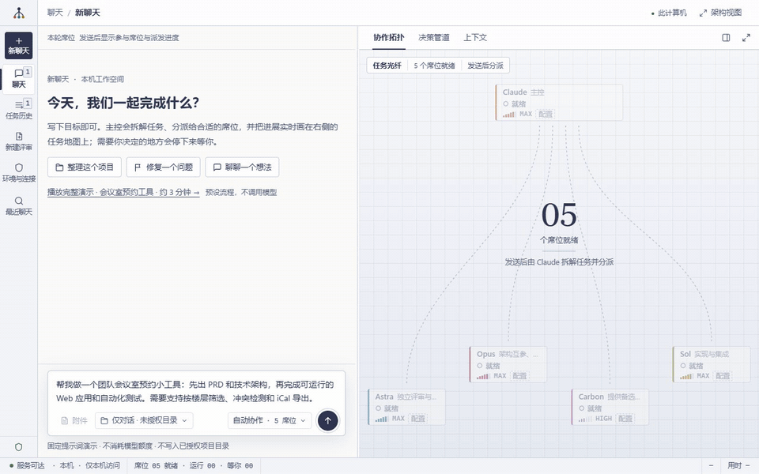](https://johnson-durui.github.io/ApexCluster/)

**[▶ Open Live Demo (No Backend, No API Keys) →](https://johnson-durui.github.io/ApexCluster/)** &nbsp;|&nbsp; **[Try the Delivered RoomDesk App →](https://johnson-durui.github.io/ApexCluster/demo-project/)**

<sub>Runs this repo's real React 19 Command Deck UI on scripted data (zero model calls; UI is in Chinese). Click <b>▶ 播放完整演示</b> in the status bar to watch RoomDesk go from idea to delivery.</sub>

</div>

---

## Why ApexCluster?

1. **Direct Local Subscription Support — Zero Extra API Fees** — Out-of-the-box local **Claude Code** (Claude Pro/Max) and **Codex CLI** (ChatGPT Plus/Pro) sign-ins for dual-model reviews (`/api/runs`, `npm run probe`) with zero API keys; adapters actively scrub all `*_API_KEY` env vars before spawning CLIs to prevent surprise API charges, alongside proof-gated local CLI chats (incl. optional Cursor CLI) and full BYOK API support.
2. **No Manual Model Picking — One Prompt Dispatches Everything** — Describe your goal once; the Lead Agent automatically decomposes work and dynamically dispatches specialized seats and `64`-way parallel worker pools (`agent_submit` / `worker_submit` / `fanout_submit`) without prompt babysitting.
3. **Best-Fit Model Workflow — Every Task Goes to the Right Lab** — `Claude Fable` leads & clarifies, `Gemini Carbon` diverges, `GPT Sol` builds, `Claude Opus` implements in isolation & cross-reviews, `GPT Astra` runs independent acceptance, and `Grok / Gemini Hydrogen / DeepSeek` power worker pools — delivering PRD + prototype at **Gate A** through verified delivery at **Gate B**.
4. **Missing Models? Orchestrate What You Have** — Start cleanly with 1, 2, or any subset of available models — **zero silent downgrade**. Before any task in Command Deck (or `POST /api/chats`), designate **any available API model or local CLI seat as Lead Agent**, pick `0–16` collaborators, and grant explicit dispatch authority (`proactive` / `explicit` / `none`); even one API provider (`single-provider`) delivers full PRDs & prototypes at Gate A.
5. **Program-Enforced Engineering Cluster — Not a Toy Script** — Weighted delegation (`4 → 3 → 2 → 1`), mandatory cross-vendor separation, lossless context window rotation, immutable `sha256:` Docker sandboxes, `CONTRACT.json`, and SHA-256 `TRACE`. **Model prose can never promote the pipeline.**

## Best-Fit Model Workflow

> **Standalone for Product Managers**: Stop at **Gate A** to take away a frozen **`PRD.md` + `ARCHITECTURE.md` + `DEV_GUIDE.md` + runnable `demo/` prototype + `CONTRACT.json`** — or confirm Gate A to continue seamlessly into cross-vendor implementation.

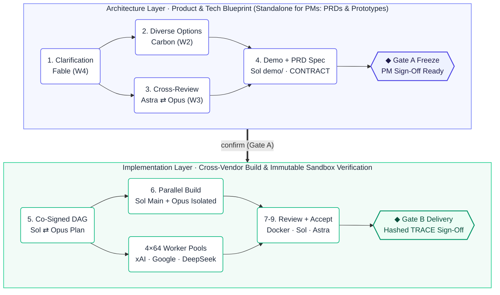

| Seat / Worker Pool | Weight | Default Model (Lab) | Best-Fit Stage & Enforced Authority |
| :--- | :---: | :--- | :--- |
| **`claude` (Lead)** | `4` | `claude-fable-5-2` (Anthropic) | Sole user interface, clarification, shared proposal & final delivery; delegates downward, no direct main writes |
| **`astra` (Secondary)** | `3` | `gpt-6.2-astra` (OpenAI) | Feasibility & risk review, **cross-family independent acceptance on a frozen copy** (`acceptance`, `exec`) |
| **`opus` (CrossRef)** | `3` | `claude-opus-5-5` (Anthropic) | Architecture critique, DAG co-signing, **isolated candidate coding** & cross-vendor review (`writeIsolated`) |
| **`carbon` (Ideator)** | `2` | `gemini-4-carbon` (Google) | Diverse architectural options, applicability bounds & blind-spot discovery without adjudication authority |
| **`sol` (Builder)** | `2` | `gpt-6.2-sol` (OpenAI) | **Sole main-workspace writer & integrator** (`writeMain`, `integrate`, `exec`); builds `demo/` |
| **`grok` / `hydrogen` / `deepseek` / `mini`** | `1` | `grok-4.7` (xAI) · `gemini-4-hydrogen` (Google)<br>`deepseek-v4-pro` (DeepSeek) · parent-matched `mini` | **4 × 64 Worker Pools**: bounded parallel coding, long-context verification, cost-efficient analysis & fast subtasks |

## Use What You Have (Local Subscriptions & Partial Models)

| What You Have Today | Ready Immediately | How It Runs (Zero Silent Downgrade) |
| :--- | :--- | :--- |
| **Local Claude Code / Codex CLI logins** | Dual-Model Reviews (OOTB) + CLI Chat Custom Teams (proof-gated) | Zero API keys, scrubs `*_API_KEY`; CLI chats let you pick `claude`/`astra`/`sol`/`grok` as **Lead Agent** |
| **1 API model / 1 provider** (e.g. OpenAI) | Solo Custom Team (`allowLeadWrite`) + `single-provider` Pipeline | Full Architecture Layer through **Gate A** (PRD, tech spec & demo) in both UI and CLI |
| **Any 2+ available models** | Command Deck **Custom Team** (UI / `POST /api/chats`) | Designate any model as **Lead Agent** + `0–16` collaborators (`collaborator`/`writer`/`reviewer`) + dispatch mode |
| **All 5 frontier API labs** | Full `flagship` Two-Layer Pipeline + 4×64 Worker Pools | Full cross-vendor implementation, isolated Docker verification, independent acceptance & `TRACE` |

| Dimension | Typical Multi-Agent Toys | ApexCluster |
| :--- | :--- | :--- |
| **Subscriptions & Cost** | Forces paid API keys or leaks env vars causing surprise bills | **OOTB Claude Code / Codex subscriptions**, scrubs all `*_API_KEY` env vars |
| **Partial Models & Lead** | Fails when a model is missing; hardcoded single lead | **Runs with any subset**; custom per-task **Lead Agent** & dispatch bounds |
| **Review Independence** | Same model grades its own homework (`"LGTM"`) | **Cross-vendor separation** (`Sol` ⇄ `Opus`) + `Astra` frozen acceptance |
| **Delivery & Sandbox** | Host shell strings; trusts LLM prose for completion | **Immutable `sha256:` offline Docker** + `CONTRACT.json` + SHA-256 `TRACE` |
| **Context & Authority** | Lossy summaries drop specs; flat loops edit anything | **Lossless window rotation** + strict weighted delegation (`4 → 3 → 2 → 1`) |

<details>
<summary><strong>Local subscription guardrails, custom-team rules &amp; <code>POST /api/chats</code> example</strong></summary>

- **Local Subscription & Honest Boundaries**:
  - **Dual-Model Reviews (`/api/runs`, `npm run probe`, Web *New Review*)**: Out-of-the-box local **Claude Code** and **Codex CLI** subscriptions (zero API keys). Adapters scrub `ANTHROPIC_API_KEY`, `ANTHROPIC_AUTH_TOKEN`, `OPENAI_API_KEY`, `CODEX_API_KEY`, `CURSOR_API_KEY`, and all `*_API_KEY` env vars before spawning CLIs; `npm run probe` checks `claude auth status` & `codex login status` and warns if API billing is active (no browser cookie scraping). Optional **Cursor Agent CLI** (Grok) requires H7 capability records.
  - **Command Deck Chat CLI Mode (`driverMode: "cli"`)**: Zero API keys and supports designating `claude`, `astra`, `sol`, or `grok` as **Lead Agent** (`cliRoster`), fail-closed behind local `capabilities/models.json` proofs + Windows Job supervisor isolation (plus WSL2 `bwrap` for Cursor chat).
  - **API Boundaries**: The v1 Two-Layer Pipeline (`npm run pipeline` and Web *Pipeline*) requires API mode; Google Gemini and DeepSeek are API-key only; single chats do not mix CLI and API seats; custom/local loopback OpenAI-compatible endpoints are supported via `config/models.registry.local.json`. See [Configuration](docs/CONFIGURATION.md#local-cli-mode).
- **Per-Task Custom Team & Freeze Rules (`FrozenChatTeam`)**:
  - `delegation` scopes Lead dispatch authority: `proactive` (autonomously decompose & dispatch), `explicit` (on demand), or `none` (solo). Toggle `allowLeadWrite` and `requireAcceptanceReview` (`400` if `true` without a `reviewer` or under `none`). `team` and `pipeline` are mutually exclusive.
  - Once created, teams freeze onto the chat (`apiRoster` or `cliRoster`). `agent_submit` (and CLI `grok_submit` when authorized) binds strictly to frozen members and fails closed with HTTP `503` if a member goes offline mid-session — never silently dropping it (default non-pipeline chats auto-prune offline seats/pools from `agent_submit` / `worker_submit` / `fanout_submit`). See [Configuration](docs/CONFIGURATION.md#per-task-custom-teams-and-lead-agent-dispatch).

```json
{
  "title": "Refactor checkout settlement", "workspaceId": "w-my-project",
  "team": {
    "leadModel": "gpt-6.2-astra", "leadEffort": "max", "delegation": "proactive",
    "allowLeadWrite": false, "requireAcceptanceReview": true,
    "members": [
      { "model": "gpt-6.2-sol", "role": "writer", "effort": "max" },
      { "model": "claude-opus-5-5", "role": "reviewer", "effort": "max" }
    ]
  }
}
```
</details>

## 30-Second Quick Start

Prerequisites: **Node.js >= 22.12**, **Git** (and **Docker** for sandboxed pipelines).

### 1. Local Subscriptions Out of the Box (Zero API Keys: Claude Code / Codex CLI)

```sh
git clone https://github.com/Johnson-Durui/ApexCluster.git && cd ApexCluster
npm ci && npm run probe                 # Zero-inference check of CLI logins & anti-billing guard
npm ci --prefix web && npm run build:web && npm start
```

Open [New Review](http://127.0.0.1:5170/#/new) (loopback-only `127.0.0.1:5170`), confirm the subscription-quota prompt, and start reviewing.

### 2. Partial Models: Command Deck Web UI & Custom Lead Agent

Copy `.env.example` to `.env` with only the provider key(s) you own, verify those providers, and launch:

```sh
npm run models:verify -- --provider openai --provider anthropic   # Zero-inference listing verify
npm ci --prefix web && npm run build:web && npm start
```

Open <http://127.0.0.1:5170> and click **Auto Collab (`自动协作`) → Custom Team (`自定义协作团队`)** to pick your **Lead Agent**, collaborators, and dispatch permissions — or select `single-provider` in Pipeline mode to generate PRDs & prototypes up to **Gate A** with one provider.

### 3. Zero-Cost Offline Docker Demo / Full Live API Pipeline

```sh
# Zero model calls, real isolated Docker sandbox end-to-end check (prints PASS)
docker build -t dmw-sandbox:local docker/sandbox && npm run demo:offline

# Live API pipeline (pin immutable image sha256: ID in config/chat.config.json first)
npm run pipeline -- --preset single-provider --requirement tests/fixtures/pipeline/todo-cli/requirement.md --workspace ./product
npm run pipeline -- --preset flagship        --requirement tests/fixtures/pipeline/todo-cli/requirement.md --workspace ./product
```

<details>
<summary><strong>CLI flags, exit codes, local demo &amp; verification commands</strong></summary>

- **Pipeline flags**: `--requirement <file>` (required), `--workspace <dir>` (required existing directory; `npm start` browser UI cannot grant new directories — use `npm run pipeline` for local directory pipelines), `--preset flagship|single-provider`, `--auto` (auto-confirm gates).
- **NDJSON exit codes**: `0` completed · `2` invalid args · `3` cancelled / non-interactive gate input required · `4` runtime failure / stall · `5` missing config / model proof / sandbox.
- **Run static demo locally**: `npm ci --prefix web && npm --prefix web run dev:demo` → <http://localhost:5180>.
- **Dev verification**: `npm run check` (typecheck + backend tests) · `npm --prefix web test` (frontend tests) · `npm run prepublish:scan` (secret & path leak scan).
</details>

## Screenshots & ⭐ Star History

| | |
|---|---|
| 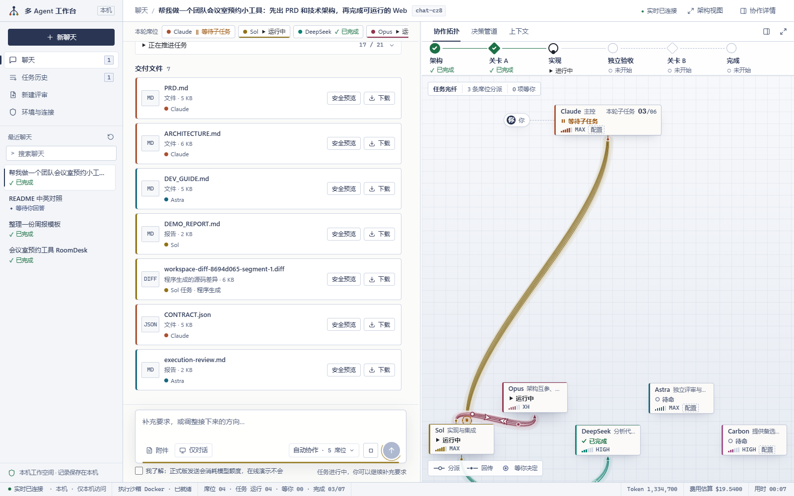<br>**Live task map**: lead splits work; seat dispatches animate along fibres | 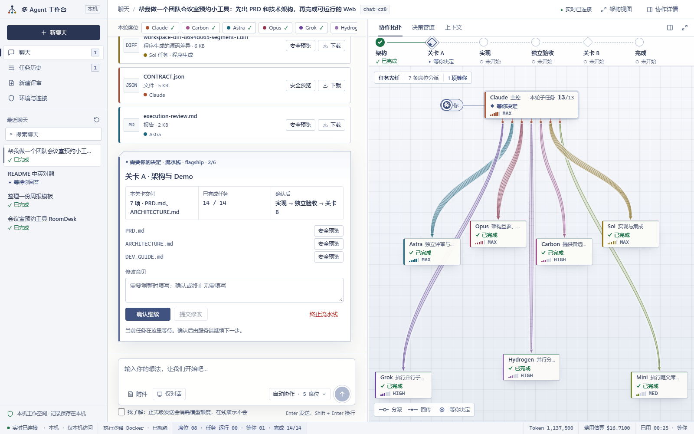<br>**Human Gate A**: stops for sign-off with frozen PRD, demo & contract |
| 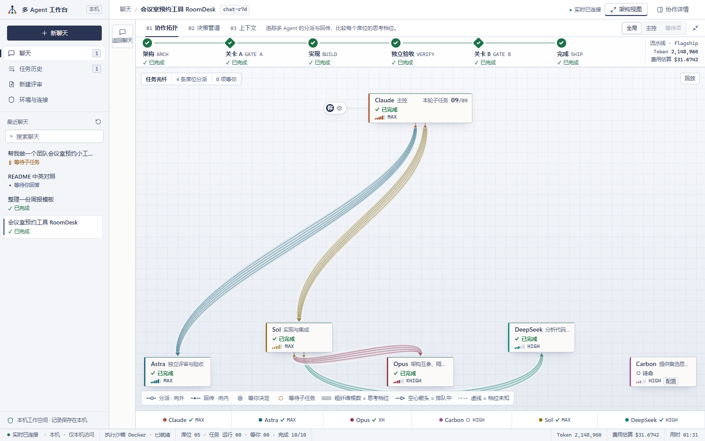<br>**Architecture view**: full-screen topology, reasoning effort & context | 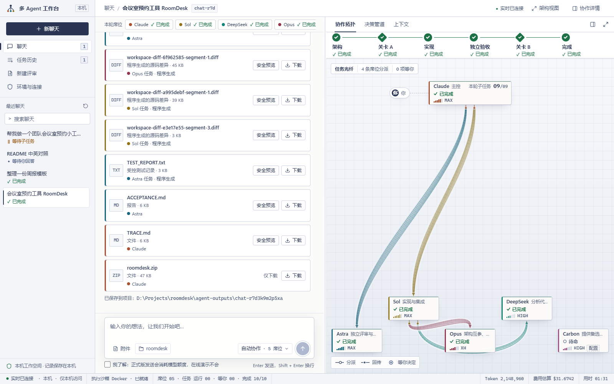<br>**Deliverables**: each artifact names its producing seat for preview/download |

<details>
<summary><strong>More screenshots (Decision Pipeline · History · Review Run · Environment · RoomDesk App)</strong></summary>

| | |
|---|---|
| 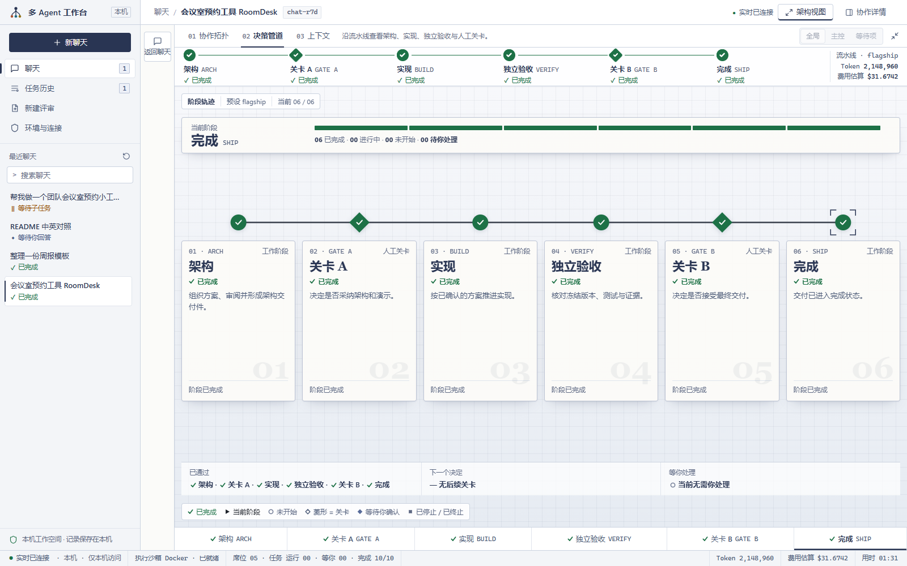<br>**Decision pipeline**: architecture → gate A → implementation → acceptance → gate B | <br>**Task history**: review runs, pending decisions & run metrics |
| 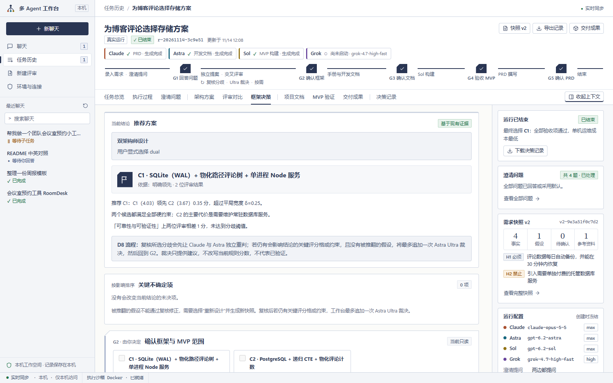<br>**Review runs**: candidate comparison & structured decision | 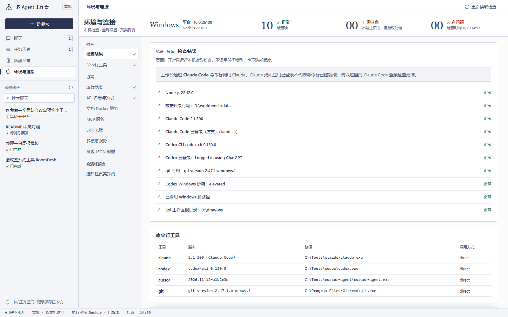<br>**Environment**: seat models, subscription/key status, sandbox & services |

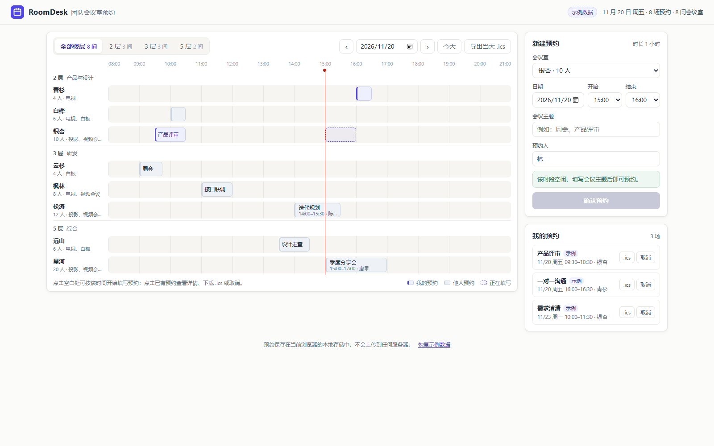

<sub>RoomDesk meeting-room booking app delivered by the demo pipeline: floor filter, conflict detection, iCal export & 30 automated tests.</sub>

</details>

<p align="center">
  <picture>
    <source media="(prefers-color-scheme: dark)" srcset="docs/images/star-surge-dark.svg" />
    <source media="(prefers-color-scheme: light)" srcset="docs/images/star-surge.svg" />
    
  </picture><br/>
  <sub>0 → 184 stars in 5 days after the first star, peaking at +28 in a single hour · <a href="https://star-history.com/#Johnson-Durui/ApexCluster&Date">Live chart →</a></sub>
</p>

---

## Documentation & License

[ARCHITECTURE.md](ARCHITECTURE.md) (Architecture & Trust Boundaries) · [docs/CONFIGURATION.md](docs/CONFIGURATION.md) (Registry, Custom Teams, Sandbox & Local CLI) · [docs/EXTENDING.md](docs/EXTENDING.md) (Extending) · [SECURITY.md](SECURITY.md) (Security) · [CHANGELOG.md](CHANGELOG.md) (Changelog) · [中文文档](README.md)

Released under the [MIT](LICENSE) License.
