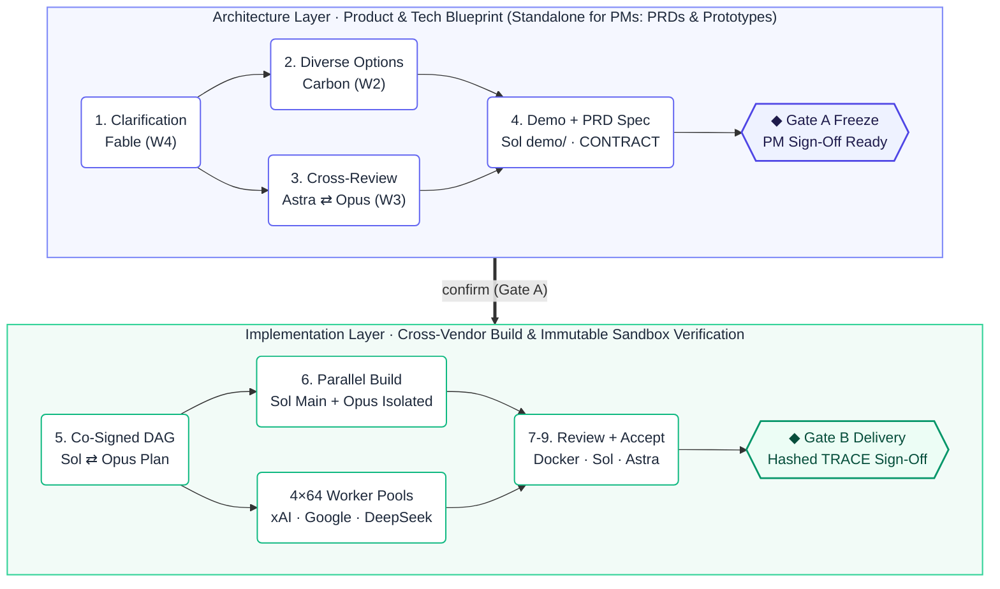

<div align="center">

<picture>
  <source media="(prefers-color-scheme: dark)" srcset="docs/images/apexcluster-logo-dark.svg" />
  <source media="(prefers-color-scheme: light)" srcset="docs/images/apexcluster-logo.svg" />
  
</picture>

# ApexCluster

**Direct Local Multi-Platform Subscriptions · One Prompt Dispatches the Right Models · Partial-Model Ready · Production-Grade Multi-Agent Cluster**

<p>
  <a href="https://johnson-durui.github.io/ApexCluster/"><strong>▶ Live Demo</strong></a> ·
  <a href="README.md">中文</a> ·
  <a href="README.en.md"><strong>English</strong></a> ·
  <a href="ARCHITECTURE.md">Architecture</a> ·
  <a href="docs/CONFIGURATION.md">Configuration</a> ·
  <a href="docs/EXTENDING.md">Extending</a> ·
  <a href="SECURITY.md">Security</a>
</p>

<p>
  <a href="https://johnson-durui.github.io/ApexCluster/"></a>
  = 22.12" />
  
  
  
  
  
</p>

[](https://johnson-durui.github.io/ApexCluster/)

**[▶ Open Live Demo (No Backend, No API Keys) →](https://johnson-durui.github.io/ApexCluster/)** &nbsp;|&nbsp; **[Try the Delivered RoomDesk App →](https://johnson-durui.github.io/ApexCluster/demo-project/)**

</div>

The online demo runs this repository's real **React 19 Command Deck** web interface on scripted preset data (zero model calls; UI is in Chinese). Click **▶ 播放完整演示** in the status bar to watch a meeting-room booking app (**RoomDesk**, with 30 automated tests) go end to end:

1. **Architecture cluster (PRD & prototype)**: multiple seats clarify requirements, explore options, and cross-review risks while the live task map animates every dispatch and return along fibres;
2. **Gate A human checkpoint**: the run pauses with the frozen PRD, architecture spec, demo, and acceptance contract for sign-off (auto-confirms after 20 s without input);
3. **Cross-vendor build & independent acceptance**: opposing provider families co-sign plans, build in isolation, cross-review, and pass independent acceptance;
4. **Gate B delivery**: preview or download the PRD, architecture spec, source code, test report, and complete project archive.

Run the same demo locally: `npm ci --prefix web && npm --prefix web run dev:demo` (open <http://localhost:5180>).

---

## Why ApexCluster?

**ApexCluster** (Multi-Agent Workbench) is a **local-first, program-governed, cross-vendor multi-agent product & software engineering cluster** built around five core capabilities:

1. **Direct Local Multi-Platform Subscriptions (No Extra API Keys)**
   The Dual-Model Review Workbench (`/api/runs`, `npm run probe`) plugs directly into your existing local **Claude Code (Claude Pro/Max)** and **Codex CLI (ChatGPT Plus/Pro)** logins with no extra API keys. Child processes automatically isolate `ANTHROPIC_API_KEY`, `OPENAI_API_KEY`, `CODEX_API_KEY`, and all `*_API_KEY` env vars so invocations stay purely on your subscription channel. Proof-gated local CLI chats (incl. optional Cursor Agent CLI) and full BYOK API mode are also supported.
2. **One Prompt Dispatches the Right Models Automatically**
   Describe your goal in a single sentence; the Lead Agent decomposes tasks and dynamically dispatches authorized flagship seats and up to `64`-way parallel worker pools (`agent_submit` / `worker_submit` / `fanout_submit`), collecting and adjudicating results without manual model switching or context copying.
3. **Best-Fit Model Workflow for Every Stage**
   Natively orchestrating **Anthropic, OpenAI, Google, xAI, and DeepSeek**: `Claude Fable` leads & clarifies, `Gemini Carbon` diverges, `GPT Sol` builds & integrates, `Claude Opus` implements in isolation & cross-reviews, `GPT Astra` runs independent acceptance, and `Grok / Gemini Hydrogen / DeepSeek` power high-concurrency worker pools — outputting a complete PRD & prototype at **Gate A** (standalone for PMs) through verified delivery at **Gate B**.
4. **Partial-Model Ready — Per-Task Teams & Custom Lead Agent**
   No need for all 5 labs: start cleanly with 1, 2, or any subset of available models, with unavailable options transparently reported and **zero silent downgrade**. In Command Deck (or `POST /api/chats`), freely designate **any available API model or local CLI seat as the Lead Agent**, pick `0–16` collaborators, and grant explicit dispatch permissions (`proactive` / `explicit` / `none`); even one API provider (`single-provider`) delivers complete PRDs & prototypes at Gate A.
5. **Production-Grade Multi-Agent Engineering Cluster**
   **Model prose can never promote the pipeline.** Weighted delegation (`4 → 3 → 2 → 1`), mandatory cross-vendor separation, lossless context window rotation, immutable `sha256:` Docker sandboxes, structured `CONTRACT.json`, and cryptographic `TRACE` enforce every engineering boundary in code.

---

## Best-Fit Model Workflow & Flagship Roster

> **Built for Product Managers too (Standalone Architecture Layer)**: Start from a rough product idea and let the cluster clarify edge cases, explore competing designs, cross-review feasibility across labs, and build an interactive `demo/` prototype — freezing **`PRD.md` + `ARCHITECTURE.md` + `DEV_GUIDE.md` + `CONTRACT.json`** at **Gate A**. Stop right at Gate A for pure PM workflows, or confirm to enter cross-vendor implementation seamlessly.



Permissions belong strictly to the **seat and phase**, never to a model string. When `delegationWeight` is configured, every agent may only dispatch work to targets with a **strictly lower weight**.

### 5 Flagship Leadership & Engineering Seats

| Seat | Weight | Default Flagship Model | Provider Family | Effort | Role & Enforced Authority |
| :--- | :---: | :--- | :--- | :---: | :--- |
| **`claude` (Lead)** | `4` | `claude-fable-5-2` | Anthropic | `max` | Sole user interface, clarification, owns shared proposal & final delivery; delegates downward, no direct main writes |
| **`astra` (Secondary)** | `3` | `gpt-6.2-astra` | OpenAI | `max` | Feasibility analysis, risk correction, **cross-family independent acceptance** (`acceptance`, `exec`) |
| **`opus` (CrossRef)** | `3` | `claude-opus-5-5` | Anthropic | `max` / `xhigh` | Architecture critique, milestone DAG co-signing, **isolated candidate coding** (`writeIsolated`) & cross-vendor review |
| **`carbon` (Ideator)** | `2` | `gemini-4-carbon` | Google | `high` | Generates diverse architectural directions, applicability bounds & blind spots without adjudication authority |
| **`sol` (Builder)** | `2` | `gpt-6.2-sol` | OpenAI | `max` | **Sole main-workspace writer & integrator** (`writeMain`, `integrate`, `exec`); builds `demo/` |

### 4 High-Concurrency Worker Pools (Weight `1`)

| Pool | Default Model | Provider Family | Max Concurrency | Active Layers | Specialty |
| :--- | :--- | :--- | :---: | :---: | :--- |
| **`grok`** | `grok-4.7` | xAI | `64` | Architecture + Implementation | Fast, bounded engineering subtasks and isolated edits |
| **`hydrogen`** | `gemini-4-hydrogen` | Google | `64` | Architecture + Implementation | Massive parallel workers, long-context analysis & verification subtasks |
| **`deepseek`** | `deepseek-v4-pro` | DeepSeek | `64` | Implementation | Implementation-layer deep code analysis & cost-efficient engineering subtasks |
| **`mini`** | Parent-matched (`claude-haiku-5-5` / `gpt-6-luna` / `gemini-4-hydrogen`) | Adaptive | `64` | Architecture | Low-cost fast subtasks matched to the parent seat's provider |

---

## Local Subscriptions & Per-Task Custom Teams (Partial-Model Ready)

The flagship roster is the full ceiling, not a starting prerequisite. ApexCluster cleanly separates **local-subscription CLI drivers** from **BYOK API key drivers**, with zero silent cross-mode switching and no browser cookie scraping:

### 1. Access Modes & Scope Matrix

| Surface / Subsystem | Auth Mode | Supported Providers / Agents | Direct Local Subscription | Channel Isolation & Exact Scope |
| :--- | :--- | :--- | :---: | :--- |
| **Dual-Model Review Workbench**<br>(`/api/runs` · `npm run probe` · Web *New Review*) | Local Subscription CLI | **Claude Code** (Claude Pro/Max)<br>**Codex CLI** (ChatGPT Plus/Pro)<br>Optional **Cursor Agent CLI** (Grok) | **✅ Out of the Box**<br>(Claude Code + Codex CLI) | Child processes automatically isolate `ANTHROPIC_API_KEY`, `ANTHROPIC_AUTH_TOKEN`, `OPENAI_API_KEY`, `CODEX_API_KEY`, `CURSOR_API_KEY`, and all `*_API_KEY` env vars to stay purely on local subscriptions; `npm run probe` verifies `claude auth status` & `codex login status`. Cursor CLI requires H7 capability records |
| **Command Deck Chat CLI Mode**<br>(`driverMode: "cli"`) | Local Subscription CLI | `claude` (Claude Code), `astra` / `sol` (Codex CLI), `grok` (Cursor Agent CLI) | **🔒 Proof-Gated**<br>(No API Keys) | Dynamic host tools + **per-task custom Lead Agent across any qualified CLI seat** (`cliRoster`); requires local `capabilities/models.json` proofs + Windows Job supervisor isolation (plus WSL2 `bwrap` for Cursor chat) |
| **Command Deck Chat API Mode**<br>(`driverMode: "api"`, default) | BYOK API Keys | Anthropic · OpenAI · Google Gemini · xAI · DeepSeek + custom/local OpenAI-compatible endpoints | Configured provider keys | Verify only the providers you own (`npm run models:verify -- --provider <p>`); supports loopback `127.0.0.1` / `localhost` endpoints via `config/models.registry.local.json`; full per-task custom team support |
| **v1 Two-Layer Flagship Pipeline**<br>(`npm run pipeline` · Web *Pipeline*) | BYOK API Keys | Same 5 labs (`single-provider` through **Gate A**; multi-family for full delivery) | API mode only | v1 Two-Layer Pipeline requires API mode; Google Gemini and DeepSeek are API-key only; single chats do not mix CLI and API seats, with zero silent downgrade |

### 2. What You Have → Ready Immediately

| What You Have Today | Ready Immediately | Behavior (Zero Silent Downgrade) |
| :--- | :--- | :--- |
| **Local Claude Code / Codex CLI subscriptions** | Dual-Model Reviews (OOTB) + CLI Chat Custom Teams (proof-gated) | No API keys needed; CLI chat lets you designate `claude`, `astra`, `sol`, or `grok` as **Lead Agent** |
| **1 API model / 1 provider** (e.g. OpenAI only) | Solo Custom Team (`allowLeadWrite`) + `single-provider` Architecture Pipeline | Select `single-provider` in both Web UI and CLI to run the full Architecture Layer through **Gate A** (PRD, tech spec & demo) |
| **Any 2+ available models** (partial API or multi-CLI) | Command Deck **Custom Team** (UI / `POST /api/chats`) | Designate any available model as **Lead Agent** + `0–16` collaborators + explicit dispatch & review permissions |
| **All 5 frontier API keys** | Full `flagship` Two-Layer Pipeline + 4×64 Worker Pools | Full cross-vendor review, isolated parallel coding, Docker independent acceptance & hashed `TRACE` |

### 3. Per-Task Custom Teams & Lead Agent Dispatch

Before sending a task in Command Deck, click **Auto Collab (`自动协作`) → Custom Team (`自定义协作团队`)** (`CollabPopover`) — or pass `team` to `POST /api/chats` (mutually exclusive with `pipeline`):

- **Freely Designate ANY Lead Agent (`leadModel`)**: Pick any verified registered model & reasoning effort in API mode, or any qualified local CLI seat (`claude`, `astra`, `sol`, `grok`) in CLI mode (no longer locked to Claude).
- **Explicit Lead Dispatch Authority (`delegation`)**: `proactive` (autonomously decompose and dispatch authorized collaborators), `explicit` (dispatch only on demand), or `none` (Lead works solo).
- **Granular Write & Independent Acceptance Controls**: Configure `allowLeadWrite` (grant Lead main-workspace write & `exec` authority) and `requireAcceptanceReview` (require an independent `reviewer` sign-off before completion; setting `true` without a `reviewer` or under `none` returns HTTP `400`).
- **Select 0–16 Collaborators (`members`)**: Assign per-member roles — `collaborator` (read-only analysis & synthesis), `writer` (main-workspace or isolated-copy implementation & `exec`), or `reviewer` (read-only snapshot verification & acceptance); unavailable options are visibly disabled and fail closed with HTTP `503`.
- **Frozen Per Session & Program-Enforced (`FrozenChatTeam`)**: Validated teams freeze onto the chat (`apiRoster` or `cliRoster`). `agent_submit` (and CLI `grok_submit` when authorized) binds strictly to frozen members and fails closed with HTTP `503` if a member goes offline mid-session — never silently dropping it (default non-pipeline chats auto-prune offline seats/pools from `agent_submit` / `worker_submit` / `fanout_submit`), alongside programmatic `delegationWeight`, `can.delegateSeats`, and `WorkspaceGateway` enforcement.

Example (`POST /api/chats` — designating a custom Lead Agent and collaborators using only OpenAI & Anthropic):

```json
{
  "title": "Refactor checkout settlement",
  "workspaceId": "w-my-project",
  "team": {
    "leadModel": "gpt-6.2-astra",
    "leadEffort": "max",
    "delegation": "proactive",
    "allowLeadWrite": false,
    "requireAcceptanceReview": true,
    "members": [
      { "model": "gpt-6.2-sol", "role": "writer", "effort": "max" },
      { "model": "claude-opus-5-5", "role": "reviewer", "effort": "max" }
    ]
  }
}
```

---

## Architecture Comparison & Core Engineering Guarantees

| Dimension | Single-Model / Typical Frameworks | ApexCluster |
| :--- | :--- | :--- |
| **Subscriptions & Access** | Forces multiple API keys or lacks local subscription channel isolation | **Local Subscriptions + BYOK Dual-Track**: Out-of-the-box **Claude Code & Codex CLI** subscriptions with automatic `*_API_KEY` env isolation; API mode supports partial-provider verification & custom endpoints |
| **Partial Models & Lead** | Breaks if one model is missing; hardcodes a single fixed lead | **Partial-Model Ready & Custom Lead Agent**: Starts cleanly with 1 or any subset of models; pick any **Lead Agent**, collaborators & dispatch bounds per task |
| **Review Independence** | Same model or same vendor grades its own output | **Mandatory Cross-Vendor Separation**: Implementation author and reviewer must belong to different model families (`Sol` [OpenAI] ⇄ `Opus` [Anthropic]); `Astra` runs independent acceptance on a frozen copy |
| **Source of Truth & Evidence** | Trusts LLM prose claiming *"Done / Tests passed"* | **Program-Owned State Machine**: Every transition binds `CONTRACT.json`, SHA-256 artifact hashes, structured `argv` command receipts & post-adoption `TRACE` |
| **Long-Horizon Context** | Lossy LLM summarization drops specs and errors | **Lossless Window Rotation**: Tracks physical limits & actual token usage, rotating early with mechanically assembled reference-preserving handoff packets |
| **Authority & Sandboxing** | Flat loops edit main dirs directly; host shell strings | **Weighted Delegation (`4 → 3 → 2 → 1`) + Immutable Docker**: Default offline non-root containers (plus WSL `bwrap` / Windows MXC) with zero key leakage |

### Six Core Engineering Guarantees

- **Zero Silent Downgrade & Verifiable Model Registry**: `config/models.registry.json` pins exact model IDs, wire protocols, physical context limits, supported reasoning efforts, and pricing. `npm run models:verify` validates availability via provider listing endpoints (**zero inference calls**); missing keys, SDK drift, or unsupported efforts fail explicitly instead of falling back.
- **Cross-Provider Family Independence**: Implementation authors and reviewers are programmatically prevented from sharing a provider family. During architecture clustering, `Astra` and `Opus` must read and acknowledge each other's paged notes before deterministic aggregation; `TRACE` is emitted post-adoption so generating it never invalidates reviewed source hashes.
- **Lossless Context Rotation & Event-Sourced Recovery**: Each invocation runs in a fresh window, tracking actual usage against `softTokens` / `hardTokens` / `hardRatio` to rotate early with mechanically assembled handoff packets; crash recovery resumes only safe windows without blindly replaying failed tasks.
- **Hard-Boundary Sandboxes & Immutable Images**: All model commands use structured `argv` arrays inside non-root offline Docker containers pinned by local immutable `sha256:` image digests, with a separate opt-in `installNetwork` channel and named caches; WSL `bwrap` and Windows MXC backends are supported via local capability proofs.
- **Conservative Pre-Request Budget Guardrails**: Before each API request, the scheduler reserves against the most conservative price tier and reconciles actual normalized usage afterward, enforced by `budget.maxUsd` and `budget.maxTokens`.
- **Local-First Tri-Mode Delivery**: One repository unites local-subscription dual-model reviews, the loopback-only (`127.0.0.1`) React 19 Command Deck UI (with per-task custom Lead & team configuration), and a CI-ready headless JSONL engineering pipeline.

---

## Screenshots

All screenshots are captured from the real Command Deck frontend running on the online demo's preset data:

| | |
|---|---|
| <br>**Live task map**: the lead splits work; dispatches and returns between seats animate along fibres | <br>**Human Gate A**: pauses where your decision is needed, listing the frozen PRD, demo & contract |
| <br>**Deliverables**: each file names its producing seat and can be safely previewed or downloaded | <br>**Architecture view**: full-screen topology, reasoning effort & context usage |
| <br>**Decision pipeline**: architecture → gate A → implementation → acceptance → gate B → done | <br>**Task history**: review runs with state, pending decisions & run metrics |
| <br>**Review runs**: candidate comparison & structured decision | <br>**Environment**: seat models, subscription/key status, execution sandbox & services |


<sub>The RoomDesk meeting-room booking app delivered by the demo pipeline: floor filter, conflict detection, and iCal export, with 30 automated tests.</sub>

---

## Quick Start

Prerequisites: **Node.js >= 22.12**, **Git** (and a running **Docker** daemon for sandboxed pipelines).

### 1. Local Subscriptions Out of the Box (No API Keys: Claude Code / Codex CLI)

If **Claude Code** (Claude Pro/Max) and **Codex CLI** (ChatGPT Plus/Pro) are already installed and signed in locally, launch the dual-model review workbench immediately:

```sh
git clone https://github.com/Johnson-Durui/ApexCluster.git && cd ApexCluster
npm ci && npm run probe                 # Zero-inference check of CLI versions & subscription logins
npm ci --prefix web && npm run build:web && npm start
```

Open [New Review](http://127.0.0.1:5170/#/new) (bound exclusively to `127.0.0.1:5170`), confirm the local subscription-quota prompt, and start reviewing. To override binary paths or model IDs, copy `config/workbench.config.example.json` to `config/workbench.config.json`.

> To also run Command Deck chats on local CLI subscriptions (including picking `claude`, `astra`, `sol`, or `grok` as Lead Agent), set `"driverMode": "cli"` in `config/chat.config.json` and supply the required [isolation capability proofs](docs/CONFIGURATION.md#local-cli-mode). `npm run pipeline` always uses the API driver.

### 2. Partial Models: Command Deck Web UI & Per-Task Custom Teams

Copy `.env.example` to `.env` with only the provider key(s) you own, verify those providers with zero inference calls, and start Command Deck:

```sh
npm run models:verify -- --provider openai --provider anthropic
npm ci --prefix web && npm run build:web && npm start
```

Open <http://127.0.0.1:5170> (raw API key values are never exposed to the browser):
- Click **Auto Collab (`自动协作`) → Custom Team (`自定义协作团队`)** next to the composer to designate any available model as **Lead Agent**, pick `0–16` collaborators & roles, and set dispatch / write / acceptance permissions (API details in [Configuration](docs/CONFIGURATION.md#per-task-custom-teams-and-lead-agent-dispatch));
- With only an OpenAI key, switch to Pipeline mode and pick `single-provider` right in the UI to produce the full PRD & prototype through **Gate A**.

> **Note**: When started via `npm start`, the browser UI cannot grant access to a new project directory. To run a full pipeline against a local directory, use `npm run pipeline` below.

### 3. Zero-Cost Offline Docker Demo / Live API Engineering Pipeline

```sh
# Recommended first check: scripted providers (0 live model calls) + real local Docker sandbox (prints PASS)
docker build -t dmw-sandbox:local docker/sandbox && npm run demo:offline

# Live API pipeline: first pin your local image sha256: ID and budget.maxUsd in config/chat.config.json
mkdir product
npm run pipeline -- --preset single-provider --requirement tests/fixtures/pipeline/todo-cli/requirement.md --workspace ./product
npm run pipeline -- --preset flagship        --requirement tests/fixtures/pipeline/todo-cli/requirement.md --workspace ./product
```

<details>
<summary><strong>CLI Options &amp; NDJSON Exit Codes</strong></summary>

| Flag | Description |
| :--- | :--- |
| `--requirement <file>` | Required UTF-8 requirement file |
| `--workspace <directory>` | Required existing product directory (accessed only after local native selection grant) |
| `--preset <name>` | Roster preset, defaulting to `flagship` (or `single-provider` / custom roster) |
| `--auto` | Automatically handle clarification and Gates A/B; without it, an interactive terminal accepts `confirm`, `revise`, or `cancel` |

Exit codes (streaming NDJSON): `0` completed · `2` invalid args/paths · `3` cancelled or gate input required in non-interactive mode · `4` runtime failure/stall · `5` missing config, model proof, or sandbox.

</details>

---

## Repository Layout, Verification & ⭐ Star History

```text
├── src/
│   ├── providers/   # Normalized Anthropic Messages, OpenAI Responses & Google GenAI adapters + ScriptedProvider
│   ├── chat/        # Durable event-sourced runtime, weighted scheduler, custom per-task teams, window rotation & tools
│   ├── pipeline/    # Architecture cluster, Gates A/B, contracts, milestone DAG, cross-review, acceptance & TRACE
│   ├── exec/        # Immutable Docker sandbox, WSL bwrap, Windows MXC & command receipts
│   └── server/      # Loopback-only local API & real-time event stream
├── web/             # React 19 + TypeScript + Vite Command Deck UI & backend-free online demo (web/demo/)
├── config/          # Exact model registry, flagship/single-provider rosters & runtime config templates
├── docker/sandbox/  # Offline non-root execution container definition
├── tests/           # Deterministic backend & frontend test suites (zero live API calls)
└── docs/            # Configuration, extending, security docs & UI screenshots
```

```sh
npm run check            # TypeScript typecheck + full backend test suite
npm ci --prefix web && npm --prefix web test && npm run build:web
npm run prepublish:scan  # Secret, personal path & identifier leak scan
```

<p align="center">
  <picture>
    <source media="(prefers-color-scheme: dark)" srcset="docs/images/star-surge-dark.svg" />
    <source media="(prefers-color-scheme: light)" srcset="docs/images/star-surge.svg" />
    
  </picture><br/>
  <sub>0 → 184 stars in 5 days after the first star, peaking at +28 in a single hour · <a href="https://star-history.com/#Johnson-Durui/ApexCluster&Date">Live chart →</a></sub>
</p>

---

## Documentation & License

- [ARCHITECTURE.md](ARCHITECTURE.md) — Two-layer pipeline design, window rotation & trust boundaries
- [docs/CONFIGURATION.md](docs/CONFIGURATION.md) — Model registry, weighted rosters, per-task custom teams & Lead Agent dispatch, budgets, Docker digest pinning & local CLI mode
- [docs/EXTENDING.md](docs/EXTENDING.md) — Adding models, providers, seats, tools & execution backends
- [SECURITY.md](SECURITY.md) — Security model, operator responsibilities, live-smoke guardrails & audit status
- [CHANGELOG.md](CHANGELOG.md) — Release history · [中文文档](README.md)

Released under the [MIT](LICENSE) License.
