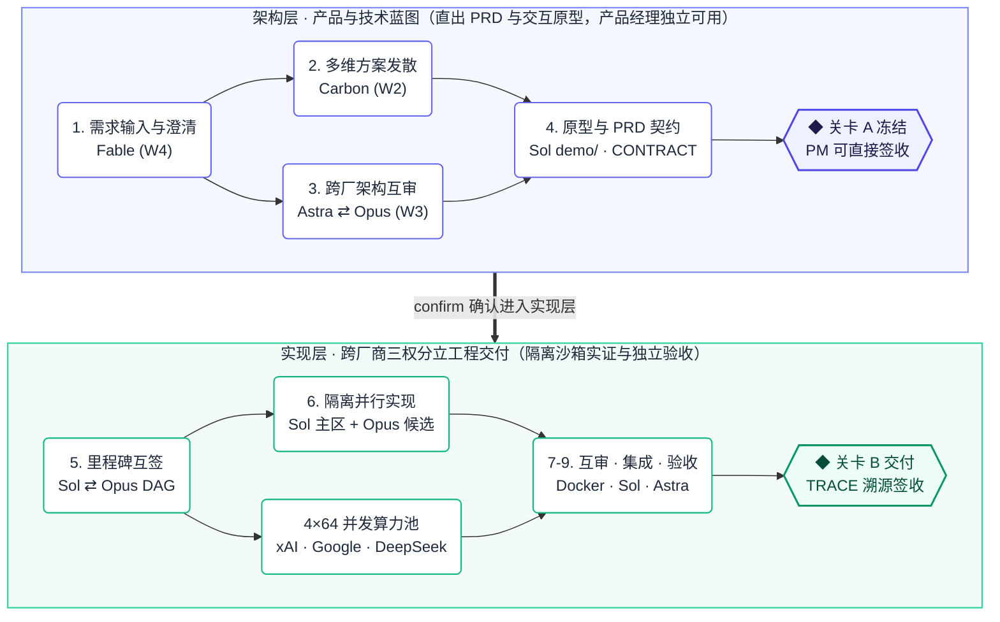

<div align="center">

<picture>
  <source media="(prefers-color-scheme: dark)" srcset="docs/images/apexcluster-logo-dark.svg" />
  <source media="(prefers-color-scheme: light)" srcset="docs/images/apexcluster-logo.svg" />
  
</picture>

# ApexCluster

**本地多平台订阅直连 · 一句话自动调度最佳模型 · 缺模型照样自由配队 · 旗舰级跨厂商多 Agent 工程集群**

<p>
  <a href="https://johnson-durui.github.io/ApexCluster/"><strong>▶ 在线演示</strong></a> ·
  <a href="README.md"><strong>中文</strong></a> ·
  <a href="README.en.md">English</a> ·
  <a href="ARCHITECTURE.md">架构设计</a> ·
  <a href="docs/CONFIGURATION.md">配置指南</a> ·
  <a href="docs/EXTENDING.md">扩展开发</a> ·
  <a href="SECURITY.md">安全模型</a>
</p>
<p>
  <a href="https://johnson-durui.github.io/ApexCluster/"></a>
  
  
  
  
  
</p>

[](https://johnson-durui.github.io/ApexCluster/)

**[▶ 立即打开在线演示（零后端、免 API Key） →](https://johnson-durui.github.io/ApexCluster/)** &nbsp;|&nbsp; **[试用演示交付的 RoomDesk 应用 →](https://johnson-durui.github.io/ApexCluster/demo-project/)**

<sub>在线演示运行本仓库真实的 React 19 Command Deck 指挥台前端（预设脚本，零模型调用）；点击底部 <b>▶ 播放完整演示</b> 即可观看 RoomDesk 从需求到交付全过程。</sub>

</div>

---

## 为什么是 ApexCluster？

1. **本地多平台订阅直接调用，零额外 API 费用防误扣** — 双模型评审工作台（`/api/runs`、`npm run probe`）**开箱即用本机已登录的 Claude Code（Claude Pro/Max）与 Codex CLI（ChatGPT Plus/Pro）订阅**，零 API Key；子进程启动前主动剥离全部 `*_API_KEY` 防止误扣按量账单，同时支持隔离证明门控的本地 CLI 聊天（含可选 Cursor CLI）与完整 BYOK API 模式。
2. **不用自己选模型，一句话自由调度** — 输入一句话需求，主 Agent 自动拆解任务并动态调用各旗舰席位与 `64` 并发 Worker 算力池（`agent_submit` / `worker_submit` / `fanout_submit`），无需手动切模型、无需来回复制粘贴。
3. **最佳模型工作流，每个环节交给最合适的模型** — `Claude Fable` 主控澄清、`Gemini Carbon` 方案发散、`GPT Sol` 主区构建、`Claude Opus` 隔离实现与跨厂评审、`GPT Astra` 独立验收，`Grok / Gemini Hydrogen / DeepSeek` 承担高并发子任务——**关卡 A** 直出 PRD 与交互原型，**关卡 B** 实证交付。
4. **缺少模型也没事，现有模型照样完美调度** — 只有 1 个、2 个或任意子集模型即可正常启动，**绝不静默降级**。在指挥台（或 `POST /api/chats`）按任务自由指定**任意可用 API 模型或本地 CLI 席位作为 `主 Agent`**，勾选 `0–16` 位协作者并授予调度权（`proactive` / `explicit` / `none`）；即使单家 API（`single-provider`）也能跑通完整架构层直出 PRD。
5. **程序掌权的复杂多 Agent 工程集群，不是玩具脚本** — 加权委派层级（`4 → 3 → 2 → 1`）、强制跨厂商制衡、无损上下文窗口轮换、不可变 `sha256:` Docker 沙箱、`CONTRACT.json` 与加密 `TRACE`——**模型口头宣称“已完成”无权推进任何阶段**。

## 最佳模型工作流与分工

> **产品经理独立可用**：架构层停在 **关卡 A** 即可直接带走完整的 **`PRD.md` + `ARCHITECTURE.md` + `DEV_GUIDE.md` + 可运行 `demo/` 原型 + `CONTRACT.json`**；需要落地研发时确认关卡 A 即可无缝进入跨厂商实现层。



| 席位 / Worker 池 | 权重 | 默认模型（厂商） | 最擅长的环节与硬权限边界 |
| :--- | :---: | :--- | :--- |
| **`claude` (Lead)** | `4` | `claude-fable-5-2` (Anthropic) | 唯一用户入口、需求澄清、统筹共同方案与交付；可向下派单，无主区直写权 |
| **`astra` (Secondary)** | `3` | `gpt-6.2-astra` (OpenAI) | 架构可行性审查、风险修正、**冻结副本跨家族独立验收**（`acceptance`, `exec`） |
| **`opus` (CrossRef)** | `3` | `claude-opus-5-5` (Anthropic) | 架构互参、里程碑互签、**隔离候选副本编码**与跨厂商代码评审（`writeIsolated`） |
| **`carbon` (Ideator)** | `2` | `gemini-4-carbon` (Google) | 多样化架构方向发散、边界条件与盲区挑战，只发散不裁决 |
| **`sol` (Builder)** | `2` | `gpt-6.2-sol` (OpenAI) | **主工作区唯一写者与集成者**（`writeMain`, `integrate`, `exec`），构建 `demo/` |
| **`grok` / `hydrogen` / `deepseek` / `mini`** | `1` | `grok-4.7` (xAI) · `gemini-4-hydrogen` (Google)<br>`deepseek-v4-pro` (DeepSeek) · 父厂商自适应 `mini` | **4 × 64 高并发 Worker 池**：并行工程子任务、超长上下文校验、高性价比代码分析与快速检索 |

## 有什么模型就用什么（缺模型 & 本地订阅）

| 你手里的模型资源 | 立即可跑的模式 | 运行效果（零静默降级） |
| :--- | :--- | :--- |
| **本机已登录 Claude Code / Codex CLI** | 双模型评审（开箱即用）+ CLI 聊天自定义团队（证明门控） | 零 API Key、自动剥离 `*_API_KEY`；CLI 聊天可自由指定 `claude`/`astra`/`sol`/`grok` 为 **`主 Agent`** |
| **仅 1 个 API 模型 / 单家厂商** | 单模型自定义团队（开启 `allowLeadWrite`）+ `single-provider` 流水线 | 界面与 CLI 均可选 `single-provider` 跑通完整架构层，在 **关卡 A** 直出 PRD、架构与原型 |
| **任意 2 个及以上可用模型** | 指挥台 **「自定义协作团队」**（UI / `POST /api/chats`） | 自由指定任意模型为 **`主 Agent`** + `0–16` 协作者（`collaborator`/`writer`/`reviewer`）+ 调度授权 |
| **配齐五大厂商 API** | 完整 `flagship` 双层流水线 + 4×64 并发池 | 解锁全自动跨厂互审、隔离实现、Docker 独立验收与加密 `TRACE` |

| 对比维度 | 常见玩具多 Agent 框架 | ApexCluster |
| :--- | :--- | :--- |
| **本地订阅与费用** | 强绑高价 API，或透传环境变量误扣账单 | **Claude Code / Codex 订阅开箱直连**，剥离全部 `*_API_KEY` 防误扣 |
| **模型弹性与主控** | 缺模型即罢工，主控角色写死不可配 | **缺模型照常启动**，按任务自由指定任意 **`主 Agent`** 与调度权限 |
| **评审独立性** | 同模型自写自审，口头输出 `"LGTM"` | **强制异厂制衡**（`Sol` ⇄ `Opus`）+ `Astra` 冻结副本独立验收 |
| **交付与沙箱** | 宿主机直接拼 shell，靠文本宣告完成 | **不可变 `sha256:` 无网 Docker** + `CONTRACT.json` + SHA-256 `TRACE` |
| **长上下文与权限** | 有损摘要丢需求，扁平循环越权乱改 | **无损窗口轮换** + 严格加权委派（`4 → 3 → 2 → 1`）与工作区隔离 |

<details>
<summary><strong>查看本地订阅边界、自定义主 Agent 规则与 <code>POST /api/chats</code> 示例</strong></summary>

- **本地订阅与防误扣边界**：
  - **双模型评审（`/api/runs`、`npm run probe`、Web「新建评审」）**：开箱复用本机 **Claude Code** 与 **Codex CLI** 订阅（零 API Key）；启动子进程前主动剥离 `ANTHROPIC_API_KEY`、`ANTHROPIC_AUTH_TOKEN`、`OPENAI_API_KEY`、`CODEX_API_KEY`、`CURSOR_API_KEY` 及全部 `*_API_KEY`，`npm run probe` 探查 `claude auth status` / `codex login status` 并在检测到 API 计费时告警（不抓取浏览器 Cookie）。可选 **Cursor Agent CLI**（Grok）需额外 H7 能力记录。
  - **指挥台 CLI 聊天（`driverMode: "cli"`）**：零 API Key，支持通过 `cliRoster` 自由指定 `claude` / `astra` / `sol` / `grok` 任一席位为**主 Agent**；但强制 Fail-Closed 门控于本地 `capabilities/models.json` 证明与 Windows Job 隔离监督器（Cursor 聊天另需 WSL2 `bwrap` 隔离）。
  - **API 模式边界**：v1 双层流水线（`npm run pipeline` 及 Web「流水线」）当前仅支持 API 模式；Google Gemini 与 DeepSeek 仅支持 API Key；单会话不支持 CLI 与 API 混编；可通过 `config/models.registry.local.json` 接入 `127.0.0.1` / `localhost` 等自定义 OpenAI 兼容端点。详见 [配置指南](docs/CONFIGURATION.md#local-cli-mode)。
- **按任务自定义团队与冻结规则（`FrozenChatTeam`）**：
  - `delegation` 控制主 Agent 调度权限：`proactive`（自主拆解调度）/ `explicit`（按需调度）/ `none`（独立执行）；`allowLeadWrite` 授予主 Agent 写入与执行权；`requireAcceptanceReview` 要求 `reviewer` 独立验收（未选 `reviewer` 或 `none` 模式下传 `true` 返回 `400`）。`team` 与 `pipeline` 互斥。
  - 创建后冻结为会话专属名册（`apiRoster` / `cliRoster`），`agent_submit`（及授权时的 CLI `grok_submit`）严格绑定已授权的冻结成员，若成员在会话中途离线则直接返回 HTTP `503`（绝不静默丢弃；默认非流水线会话会自动从 `agent_submit` / `worker_submit` / `fanout_submit` 裁剪离线席位与算力池）。详见 [配置指南](docs/CONFIGURATION.md#per-task-custom-teams-and-lead-agent-dispatch)。

```json
{
  "title": "重构订单结算模块", "workspaceId": "w-my-project",
  "team": {
    "leadModel": "gpt-6.2-astra", "leadEffort": "max", "delegation": "proactive",
    "allowLeadWrite": false, "requireAcceptanceReview": true,
    "members": [
      { "model": "gpt-6.2-sol", "role": "writer", "effort": "max" },
      { "model": "claude-opus-5-5", "role": "reviewer", "effort": "max" }
    ]
  }
}
```
</details>

## 30 秒快速开始

环境要求：**Node.js >= 22.12**、**Git**（运行沙箱流水线需 **Docker**）。

### 1. 本机已有订阅直接开跑（零 API Key：Claude Code / Codex CLI）

```sh
git clone https://github.com/Johnson-Durui/ApexCluster.git && cd ApexCluster
npm ci && npm run probe                 # 零推理检查本地订阅登录态与防误扣状态
npm ci --prefix web && npm run build:web && npm start
```

打开 [新建评审](http://127.0.0.1:5170/#/new)（仅监听 `127.0.0.1:5170`），确认订阅额度提示即可发起跨模型评审。

### 2. 模型不齐全：用已有 API Key 启动指挥台并按任务自由配队

复制 `.env.example` 为 `.env`，只填你拥有的厂商 Key，按需核对后启动指挥台：

```sh
npm run models:verify -- --provider openai --provider anthropic   # 零推理核对已有厂商
npm ci --prefix web && npm run build:web && npm start
```

打开 <http://127.0.0.1:5170>，点击输入框旁的 **「自动协作 → 自定义协作团队」**，自由指定 **主 Agent**、协作者角色与调度权限；若仅配了 OpenAI Key，也可直接选 `single-provider` 跑完架构层至 **关卡 A** 导出 PRD 与原型。

### 3. 零费用离线 Docker 全链路演练 / 完整 API 流水线

```sh
# 零模型调用、真实 Docker 沙箱端到端验证（成功时末尾输出 PASS）
docker build -t dmw-sandbox:local docker/sandbox && npm run demo:offline

# 真实 API 流水线（先在 config/chat.config.json 钉死镜像 sha256: ID，详见配置指南）
npm run pipeline -- --preset single-provider --requirement tests/fixtures/pipeline/todo-cli/requirement.md --workspace ./product
npm run pipeline -- --preset flagship        --requirement tests/fixtures/pipeline/todo-cli/requirement.md --workspace ./product
```

<details>
<summary><strong>查看 CLI 参数、退出码、本地演示与质量检查命令</strong></summary>

- **流水线参数**：`--requirement <file>`（必填需求）、`--workspace <dir>`（必填已有产品目录；浏览器 `npm start` 无法授权新产品目录，完整目录流水线请用 `npm run pipeline`）、`--preset flagship|single-provider`、`--auto`（自动通过关卡）。
- **NDJSON 退出码**：`0` 完成 · `2` 参数无效 · `3` 取消/非交互需人工决策 · `4` 失败/停滞 · `5` 配置/模型证明/沙箱不可用。
- **本机启动静态在线演示**：`npm ci --prefix web && npm --prefix web run dev:demo` → <http://localhost:5180>。
- **开发验证**：`npm run check`（类型检查 + 后端测试）· `npm --prefix web test`（前端测试）· `npm run prepublish:scan`（敏感信息与泄露扫描）。
</details>

## 界面实景与 ⭐ Star 涨势

| | |
|---|---|
| <br>**实时任务地图**：主控拆解任务，席位分派与回传以光纤动画实时呈现 | <br>**人工关卡 A**：自动停下并列出 PRD、原型与验收契约供签收 |
| <br>**全屏架构视图**：实时观测协作拓扑、推理强度与上下文用量 | <br>**交付物面板**：每份产物标明产出席位，支持安全预览与下载 |

<details>
<summary><strong>展开更多界面截图（决策管道 · 任务历史 · 评审决策 · 环境连接 · RoomDesk 成品）</strong></summary>

| | |
|---|---|
| <br>**决策管道**：架构 → 关卡 A → 实现 → 独立验收 → 关卡 B → 完成 | <br>**任务历史**：运行状态、等待人工项与度量汇总 |
| <br>**评审运行**：多候选方案对比与结构化决策 | <br>**环境与连接**：席位型号、订阅/密钥状态、执行沙箱与扩展服务 |


<sub>演示流水线交付的 RoomDesk 会议室预约应用：楼层筛选、实时冲突检测、iCal 导出，附 30 个自动化测试。</sub>

</details>

<p align="center">
  <picture>
    <source media="(prefers-color-scheme: dark)" srcset="docs/images/star-surge-dark.svg" />
    <source media="(prefers-color-scheme: light)" srcset="docs/images/star-surge.svg" />
    
  </picture><br/>
  <sub>首颗 star 后 5 天 0 → 184，单小时峰值 +28 · <a href="https://star-history.com/#Johnson-Durui/ApexCluster&Date">查看实时曲线 →</a></sub>
</p>

---

## 深入文档与许可证

[ARCHITECTURE.md](ARCHITECTURE.md)（架构与信任边界） · [docs/CONFIGURATION.md](docs/CONFIGURATION.md)（注册表、自定义团队、沙箱与本地 CLI） · [docs/EXTENDING.md](docs/EXTENDING.md)（扩展开发） · [SECURITY.md](SECURITY.md)（安全模型） · [CHANGELOG.md](CHANGELOG.md)（变更日志） · [English README](README.en.md)

基于 [MIT](LICENSE) 协议开源。
