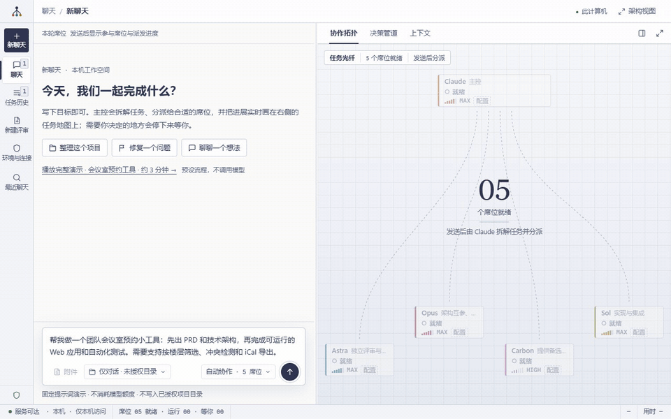
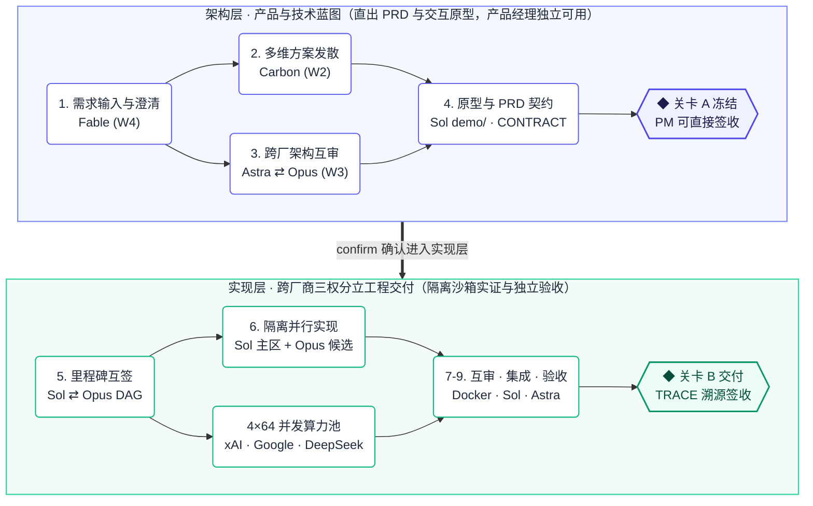
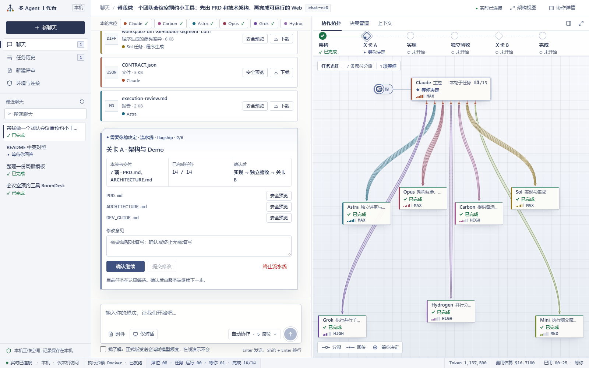
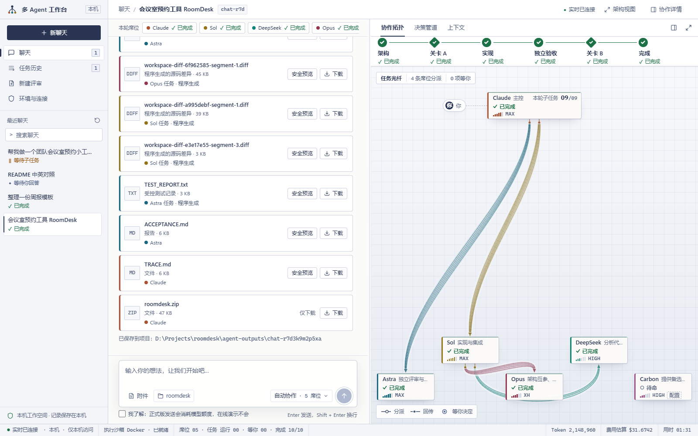
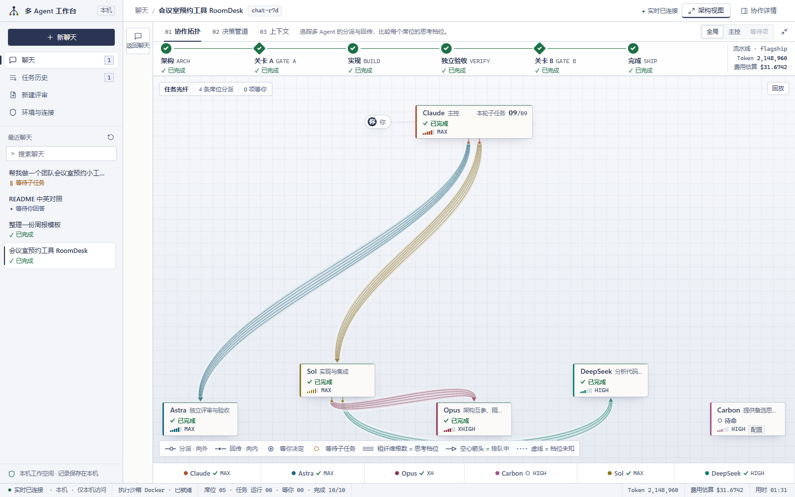
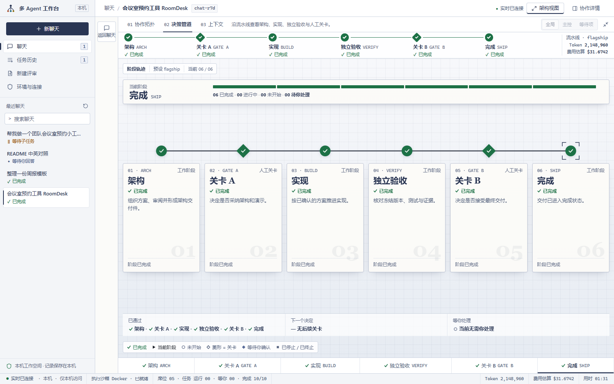
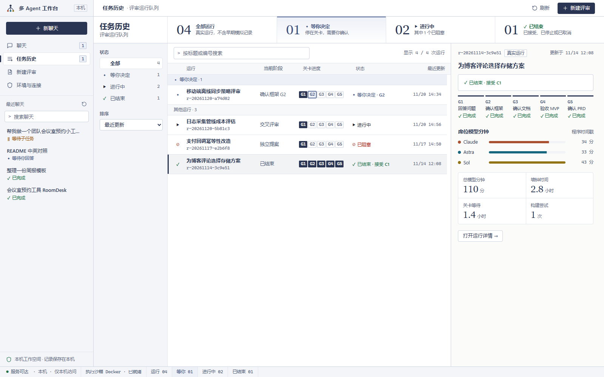
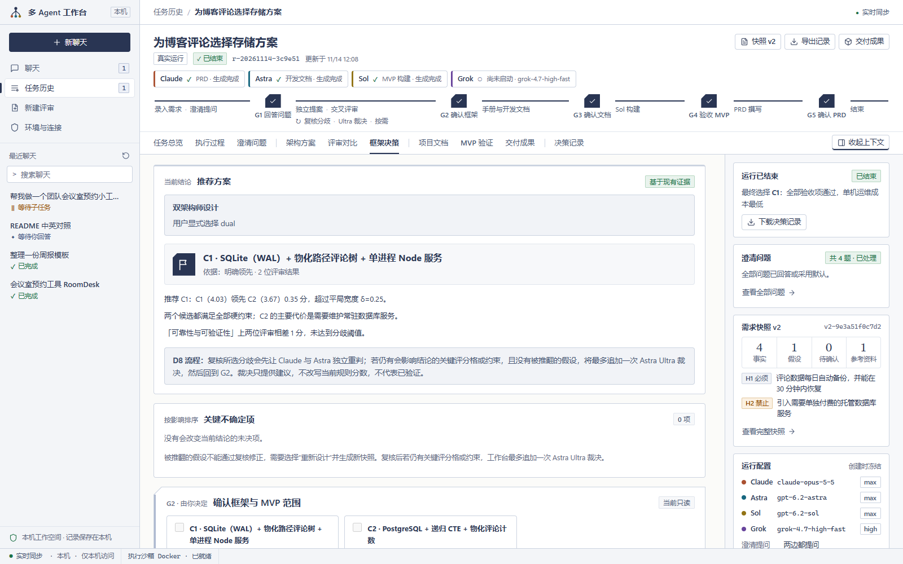

<div align="center">

<picture>
  <source media="(prefers-color-scheme: dark)" srcset="docs/images/apexcluster-logo-dark.svg" />
  <source media="(prefers-color-scheme: light)" srcset="docs/images/apexcluster-logo.svg" />
  
</picture>

# ApexCluster

**本地多平台订阅直接调用 · 一句话自动调度最佳模型 · 缺模型照样自由配队 · 生产级跨厂商多 Agent 工程集群**

<p>
  <a href="https://johnson-durui.github.io/ApexCluster/"><strong>▶ 在线演示</strong></a> ·
  <a href="README.md"><strong>中文</strong></a> ·
  <a href="README.en.md">English</a> ·
  <a href="ARCHITECTURE.md">架构设计</a> ·
  <a href="docs/CONFIGURATION.md">配置指南</a> ·
  <a href="docs/EXTENDING.md">扩展开发</a> ·
  <a href="SECURITY.md">安全模型</a>
</p>

<p>
  <a href="https://johnson-durui.github.io/ApexCluster/"></a>
  = 22.12" />
  
  
  
  
  
</p>

[](https://johnson-durui.github.io/ApexCluster/)

**[▶ 立即打开在线演示（零后端、免 API Key） →](https://johnson-durui.github.io/ApexCluster/)** &nbsp;|&nbsp; **[试用演示交付的 RoomDesk 应用 →](https://johnson-durui.github.io/ApexCluster/demo-project/)**

</div>

在线演示运行本仓库真实的 **React 19 Command Deck 指挥台前端**（预设脚本，零模型调用）。点击底部状态栏 **「▶ 播放完整演示」**，即可观看会议室预约工具 **RoomDesk**（附 30 个自动化测试）的完整交付链路：

1. **架构集群产出 PRD 与原型**：多席位并行完成需求澄清、方案发散与跨厂互评，右侧任务地图以光纤动画实时呈现每次分派与回传；
2. **关卡 A 人工决策**：系统自动停下并列出 PRD、架构文档、原型与验收契约供签收（20 秒无操作自动继续）；
3. **跨厂商实现与独立验收**：异厂席位互签计划、并行实现、交叉评审并由独立席位验收；
4. **关卡 B 交付签收**：PRD、架构文档、源码、测试报告与完整项目包均可安全预览或下载。

在本机启动同一份演示：`npm ci --prefix web && npm --prefix web run dev:demo`（打开 <http://localhost:5180>）。

---

## 五大核心优势

**ApexCluster**（Multi-Agent Workbench）是一套**本机运行、程序掌权、跨厂商三权分立的生产级多 Agent 产品与软件工程集群**，围绕五个核心能力打造：

1. **本地多平台订阅直接调用，无需额外购买 API**
   双模型评审工作台（`/api/runs`、`npm run probe`）开箱复用本机已登录的 **Claude Code（Claude Pro/Max）** 与 **Codex CLI（ChatGPT Plus/Pro）** 订阅，无需额外 API Key；子进程启动前自动隔离 `ANTHROPIC_API_KEY`、`OPENAI_API_KEY`、`CODEX_API_KEY` 及全部 `*_API_KEY` 环境变量，确保严格走本地订阅通道。同时支持经隔离证明门控的本地 CLI 聊天（含可选 Cursor Agent CLI）与完整 BYOK API 模式。
2. **不用自己选模型，一句话自由调度**
   输入一句话业务目标，主 Agent 即可自动拆解任务边界，动态调度授权的旗舰席位与最高 `64` 并发的 Worker 算力池（`agent_submit` / `worker_submit` / `fanout_submit`），并回收校验结果——告别手工切模型、人工搬运上下文的繁琐流程。
3. **最佳模型工作流，每个环节交给最擅长的模型**
   原生编排 **Anthropic · OpenAI · Google · xAI · DeepSeek** 五大前沿厂商：`Claude Fable` 主控澄清、`Gemini Carbon` 方案发散、`GPT Sol` 主区构建与集成、`Claude Opus` 隔离编码与跨厂评审、`GPT Astra` 独立验收，`Grok / Gemini Hydrogen / DeepSeek` 承担高并发子任务——**关卡 A** 直出完整 PRD 与原型（产品经理独立可用），**关卡 B** 沙箱实证交付。
4. **缺少模型也没事，现有模型照样完美调度**
   无需配齐 5 家厂商——仅有 1 个、2 个或任意子集模型即可直接启动，缺失模型清晰标明原因、**绝不静默降级**。在指挥台（或 `POST /api/chats`）中可按任务自由指定**任意可用 API 模型或本地 CLI 席位作为 `主 Agent`**，选配 `0–16` 位协作者并显式授予调度权限（`proactive` / `explicit` / `none`）；即使只有单家 API（`single-provider`），也能跑通完整架构层直出 PRD 与原型。
5. **生产级复杂多 Agent 工程集群，程序掌权**
   **模型文本无权推进流水线。** 严格加权委派（`4 → 3 → 2 → 1`）、跨厂商家族隔离、无损上下文窗口轮换、不可变 `sha256:` Docker 沙箱、`CONTRACT.json` 结构化契约与加密 `TRACE` 共同构成代码级工程护栏。

---

## 最佳模型工作流与旗舰编组

> **产品经理独立可用（架构层直出 PRD 与原型）**：输入原始业务想法，架构层并行完成需求澄清、方案发散、跨厂商可行性互审与交互式 `demo/` 原型构建，在 **关卡 A** 冻结输出 **`PRD.md` + `ARCHITECTURE.md` + `DEV_GUIDE.md` + `CONTRACT.json`**。纯产品规划与原型评审可直接签收带走；需要落地研发时，确认关卡 A 即可无缝进入跨厂商实现层。



所有席位权限绑定在**席位与阶段**，而非模型名称；开启 `delegationWeight` 后，任何 Agent 只能向**权重严格更低**的目标派单，杜绝权限倒挂。

### 5 大旗舰决策与工程席位

| 席位 | 权重 | 默认旗舰模型 | 厂商家族 | 推理强度 | 核心职责与硬权限边界 |
| :--- | :---: | :--- | :--- | :---: | :--- |
| **`claude` (Lead)** | `4` | `claude-fable-5-2` | Anthropic | `max` | 唯一用户入口、需求澄清、维护共同方案与最终交付；可向下委派，无主区直写权 |
| **`astra` (Secondary)** | `3` | `gpt-6.2-astra` | OpenAI | `max` | 架构可行性审查、风险修正、**跨家族独立验收**（`acceptance`, `exec`） |
| **`opus` (CrossRef)** | `3` | `claude-opus-5-5` | Anthropic | `max` / `xhigh` | 架构并行互参、实现计划互签、**隔离候选副本实现**（`writeIsolated`）与跨厂评审 |
| **`carbon` (Ideator)** | `2` | `gemini-4-carbon` | Google | `high` | 提供多样化架构方案、适用边界与潜在盲区，专注发散、不作裁决 |
| **`sol` (Builder)** | `2` | `gpt-6.2-sol` | OpenAI | `max` | **主工作区唯一写者与集成者**（`writeMain`, `integrate`, `exec`），构建 `demo/` |

### 4 大高并发 Worker 算力池（Weight `1`）

| 算力池 | 默认模型 | 厂商家族 | 并发上限 | 适用阶段 | 专长任务 |
| :--- | :--- | :--- | :---: | :---: | :--- |
| **`grok`** | `grok-4.7` | xAI | `64` | 架构层 + 实现层 | 高速、工程化的有界子任务与隔离副本编辑 |
| **`hydrogen`** | `gemini-4-hydrogen` | Google | `64` | 架构层 + 实现层 | 大规模并行 worker、超长上下文分析与校验型子任务 |
| **`deepseek`** | `deepseek-v4-pro` | DeepSeek | `64` | 实现层 | 实现层深度代码分析与高性价比有界工程子任务 |
| **`mini`** | 随父席位自适应 (`claude-haiku-5-5` / `gpt-6-luna` / `gemini-4-hydrogen`) | 自适应 | `64` | 架构层 | 随父席位厂商自动匹配的低成本快速子任务 |

---

## 本地多平台订阅与按任务自由配队（缺模型也能用）

旗舰名册是完整能力上限，而非起步门槛。ApexCluster 清晰划分**本地订阅 CLI** 与 **BYOK API Key** 两条执行路径，零静默跨模式切换，也不抓取浏览器 Cookie：

### 1. 接入方式与能力边界

| 使用场景 / 子系统 | 鉴权方式 | 支持的模型 / 厂商 | 本地订阅直接可用 | 通道隔离与能力边界 |
| :--- | :--- | :--- | :---: | :--- |
| **双模型评审工作台**<br>（`/api/runs` · `npm run probe` · Web「新建评审」） | 本地订阅 CLI | **Claude Code**（Claude Pro/Max）<br>**Codex CLI**（ChatGPT Plus/Pro）<br>可选 **Cursor Agent CLI**（Grok） | **✅ 开箱即用**<br>（Claude Code + Codex CLI） | 子进程自动剥离 `ANTHROPIC_API_KEY`、`ANTHROPIC_AUTH_TOKEN`、`OPENAI_API_KEY`、`CODEX_API_KEY`、`CURSOR_API_KEY` 及全部 `*_API_KEY`，严格走本地订阅通道；`npm run probe` 核验 `claude auth status` 与 `codex login status`。Cursor CLI 需 H7 能力记录 |
| **指挥台 CLI 聊天模式**<br>（`driverMode: "cli"`） | 本地订阅 CLI | `claude`（Claude Code）、`astra` / `sol`（Codex CLI）、`grok`（Cursor Agent CLI） | **🔒 隔离证明门控**<br>（无需 API Key） | 支持动态宿主机工具与**按任务自由指定任意已验证 CLI 席位作为主 Agent**（`cliRoster`）；需本地能力证明 `capabilities/models.json` 与 Windows Job 隔离监督器（Cursor 聊天另需 WSL2 `bwrap` 隔离） |
| **指挥台 API 聊天模式**<br>（`driverMode: "api"`，默认） | BYOK API Key | Anthropic · OpenAI · Google Gemini · xAI · DeepSeek + 自定义/本地 OpenAI 兼容端点 | 配置已有厂商 Key | 支持按需仅核对已有厂商（`npm run models:verify -- --provider <p>`）；通过 `config/models.registry.local.json` 可接入 `127.0.0.1` / `localhost` 等 OpenAI 兼容端点；完整支持按任务自由配队 |
| **v1 双层旗舰流水线**<br>（`npm run pipeline` · Web「流水线」） | BYOK API Key | 同上五大厂商（单厂商 `single-provider` 至**关卡 A**；跨厂商跑完整实现） | 仅 API 模式 | v1 双层流水线强制要求 API 模式；Google Gemini 与 DeepSeek 仅支持 API Key；单会话内不支持 CLI 与 API 混编，且无静默降级 |

### 2. 你手里有什么模型，就能直接跑什么

| 你当前拥有的模型资源 | 立即可跑的模式 | 运行效果（零静默降级） |
| :--- | :--- | :--- |
| **本机已登录 Claude Code / Codex CLI 订阅** | 双模型评审（开箱即用）+ CLI 聊天自定义团队（证明门控） | 无需 API Key；CLI 聊天可自由指定 `claude` / `astra` / `sol` / `grok` 任一席位作为 **`主 Agent`** |
| **仅 1 个 API 模型 / 单家厂商**（如仅 OpenAI） | 单模型自定义团队（开启 `allowLeadWrite`）+ `single-provider` 架构流水线 | Web UI 与 CLI 均可选 `single-provider` 跑通完整架构层，在 **关卡 A** 产出 PRD、架构文档与原型 |
| **任意 2 个及以上可用模型**（部分 API 或多 CLI） | 指挥台 **「自定义协作团队」**（UI / `POST /api/chats`） | 自由指定任意可用模型为 **`主 Agent`** + `0–16` 位协作者 + 显式调度与验收权限 |
| **五大厂商 API 配齐** | 完整 `flagship` 双层流水线 + 4×64 高并发 Worker 池 | 解锁全自动跨厂互审、隔离并行编码、Docker 独立验收与加密 `TRACE` 交付 |

### 3. 按任务自定义团队与主 Agent 授权调度

在指挥台发消息前点击输入框旁的 **「自动协作 → 自定义协作团队」**（`CollabPopover`），或调用 `POST /api/chats` 传入 `team` 字段（与 `pipeline` 互斥），即可按任务灵活编排：

- **自由指定主 Agent（`leadModel`）**：API 模式任选已核对注册模型与推理档位；本地 CLI 模式任选 `claude` / `astra` / `sol` / `grok`（不再固定于 Claude）。
- **显式授予调度权限（`delegation`）**：`proactive`（主 Agent 自主拆解并调度授权协作者）/ `explicit`（仅按需委派）/ `none`（主 Agent 独立执行）。
- **精细读写与独立验收控制**：按任务配置 `allowLeadWrite`（主 Agent 直接写入工作区与执行命令）与 `requireAcceptanceReview`（交付前要求 `reviewer` 独立验收；未选 `reviewer` 或 `none` 模式下强制开启返回 HTTP `400`）。
- **按需编配 0–16 位协作者（`members`）**：为每位协作者分配职责——`collaborator`（只读分析与方案补充）、`writer`（主区或隔离副本实现与执行）、`reviewer`（只读快照独立评审与验收）；未就绪模型灰显标明原因并拦截（HTTP `503`）。
- **会话级冻结与代码强校验（`FrozenChatTeam`）**：任务创建即冻结该会话专属名册（`apiRoster` / `cliRoster`），`agent_submit`（及授权时的 CLI `grok_submit`）严格绑定已授权冻结成员，若成员中途离线直接返回 HTTP `503` 绝不静默丢弃（默认非流水线会话会自动从 `agent_submit` / `worker_submit` / `fanout_submit` 裁剪离线席位与算力池），并由 `delegationWeight`、`can.delegateSeats` 与 `WorkspaceGateway` 强约束边界。

示例（`POST /api/chats` — 仅有 OpenAI + Anthropic 时，自由指定主 Agent 与授权协作者）：

```json
{
  "title": "重构订单结算模块",
  "workspaceId": "w-my-project",
  "team": {
    "leadModel": "gpt-6.2-astra",
    "leadEffort": "max",
    "delegation": "proactive",
    "allowLeadWrite": false,
    "requireAcceptanceReview": true,
    "members": [
      { "model": "gpt-6.2-sol", "role": "writer", "effort": "max" },
      { "model": "claude-opus-5-5", "role": "reviewer", "effort": "max" }
    ]
  }
}
```

---

## 工程对比与六大核心保障

| 维度 | 单模型 / 常规多 Agent 方案 | ApexCluster |
| :--- | :--- | :--- |
| **订阅与接入模式** | 强绑多份 API Key，或缺少本地订阅隔离机制 | **本地订阅 + BYOK 双轨并行**：双模型评审开箱复用 **Claude Code / Codex CLI** 订阅并自动隔离 `*_API_KEY`；API 模式支持部分厂商核验与自定义端点 |
| **模型弹性与主控编排** | 缺一个模型就整体不可用，主控角色写死不可调 | **缺模型照常协同 · 自由指定主 Agent**：任意 1 个或子集模型即可启动，按任务自由指定 **`主 Agent`**、协作者与调度边界 |
| **评审独立性** | 同模型或同厂商自写自审，容易互相放水 | **强制跨厂商制衡**：作者与评审必须来自不同厂商家族（`Sol` [OpenAI] ⇄ `Opus` [Anthropic]），并由 `Astra` 在冻结副本上独立验收 |
| **完成判定与证据链** | 依赖模型文本自述“已完成 / 测试通过” | **实证驱动状态机**：阶段流转绑定 `CONTRACT.json`、SHA-256 产物哈希、结构化 `argv` 命令回执与采纳后 `TRACE` |
| **超长上下文治理** | 满窗后用有损摘要覆盖上下文，丢失原始需求 | **无损窗口轮换**：基于物理上限与真实用量提前开窗，由程序机械组装保留原始引用与回执的交接包 |
| **并发、权限与沙箱** | 扁平循环、任意改主目录、宿主机裸跑 shell | **加权委派 (`4 → 3 → 2 → 1`) + 不可变 Docker 沙箱**：默认无网非 root 容器（支持 WSL `bwrap` / Windows MXC），密钥零透传 |

### 六大核心工程保障

- **零静默降级与可证明模型注册表**：`config/models.registry.json` 严格钉死精确模型 ID、协议、物理上下文上限、推理档位与单价。`npm run models:verify` 仅通过 listing 接口零推理核验；缺密钥、SDK 版本漂移或档位不支持均显式拦截，绝不静默替换模型。
- **跨厂商独立性与防自审契约**：实现阶段强制作者与评审分属不同模型家族；架构集群阶段 `Astra` 与 `Opus` 须真实读取对方分页意见并回执确认；`TRACE` 在源码采纳后生成，保证已评审源码哈希不被污染。
- **无损上下文窗口轮换与事件溯源恢复**：每次调用均为干净窗口，追踪真实 Token 消耗并在触及 `softTokens` / `hardTokens` / `hardRatio` 前自动开窗交接；异常中断仅恢复安全窗口，不盲目重放失败任务。
- **强隔离沙箱与不可变镜像钉死**：所有命令采用结构化 `argv` 数组，默认运行在绑定本地 `sha256:` 不可变摘要的无网非 root Docker 容器中，依赖安装走独立受控 `installNetwork` 通道与命名缓存卷；同时支持经能力证明的 WSL `bwrap` 与 Windows MXC。
- **先预留、后核算的预算硬护栏**：每次 API 请求前按保守价格档位预留额度，返回后按真实标准化用量结算，由 `budget.maxUsd` 与 `budget.maxTokens` 严格兜底。
- **本地优先三端协同**：一套仓库同时覆盖本机订阅双模型评审、仅监听 `127.0.0.1` 的 React 19 指挥台（支持按任务自定义主 Agent 与团队）以及适合 CI 集成的无头 JSONL 工程流水线。

---

## 界面实景预览

以下截图均取自本仓库真实 Command Deck 前端（在线演示预设数据）：

| | |
|---|---|
| <br>**实时任务地图**：主控拆解任务，席位分派与回传以光纤动画实时呈现 | <br>**人工关卡 A**：需要决策时自动停下，列出本关 PRD、原型与契约 |
| <br>**交付物面板**：每份产物标明产出席位，支持安全预览或下载 | <br>**全屏架构视图**：查看协作拓扑、推理强度与上下文用量 |
| <br>**决策管道**：架构 → 关卡 A → 实现 → 独立验收 → 关卡 B → 完成 | <br>**任务历史**：评审运行状态、等待人工项与运行度量 |
| <br>**评审运行**：多候选方案对比与结构化决策 | <br>**环境与连接**：席位型号、订阅/密钥状态、执行沙箱与扩展服务 |


<sub>演示流水线最终交付的 RoomDesk 会议室预约应用：按楼层筛选、实时冲突检测与 iCal 导出，附带 30 个自动化测试。</sub>

---

## 快速开始

环境要求：**Node.js >= 22.12**、**Git**（运行沙箱工程流水线需运行中的 **Docker**）。

### 1. 本机已有订阅直接开跑（无需 API Key：Claude Code / Codex CLI）

已在本机安装并登录 **Claude Code**（Claude Pro/Max）与 **Codex CLI**（ChatGPT Plus/Pro）后，可直接启动双模型评审工作台：

```sh
git clone https://github.com/Johnson-Durui/ApexCluster.git && cd ApexCluster
npm ci && npm run probe                 # 零推理核查本地 CLI 版本与订阅登录态
npm ci --prefix web && npm run build:web && npm start
```

打开 [新建评审](http://127.0.0.1:5170/#/new)（服务仅监听 `127.0.0.1:5170`），确认订阅额度提示即可发起跨模型评审。如需覆盖二进制路径或模型 ID，可复制 `config/workbench.config.example.json` 为 `config/workbench.config.json`。

> 若希望指挥台「新聊天」也使用本地 CLI 订阅（含自定义 `claude` / `astra` / `sol` / `grok` 为主 Agent），请在 `config/chat.config.json` 中设置 `"driverMode": "cli"` 并按 [本地 CLI 模式文档](docs/CONFIGURATION.md#local-cli-mode) 准备隔离能力证明；`npm run pipeline` 始终使用 API 模式。

### 2. 模型不齐全：用已有 API Key 启动指挥台并按任务自由配队

复制 `.env.example` 为 `.env`，只填入你手里拥有的厂商 Key，按需零推理核验后启动：

```sh
npm run models:verify -- --provider openai --provider anthropic
npm ci --prefix web && npm run build:web && npm start
```

打开 <http://127.0.0.1:5170>（后端绝不向前端暴露密钥值）：
- 点击输入框旁 **「自动协作 → 自定义协作团队」**，任选可用模型作为 **主 Agent**、勾选 `0–16` 位协作者与职责、设定调度及读写/验收权限（API 详见 [配置指南](docs/CONFIGURATION.md#per-task-custom-teams-and-lead-agent-dispatch)）；
- 若只配了 OpenAI Key，也可在「流水线」模式中直接选择 `single-provider` 跑通架构层并在 **关卡 A** 导出 PRD 与原型。

> **注意**：通过 `npm start` 启动时，浏览器端无法授权新的本地产品目录；针对本地目录运行完整工程流水线请使用下方 `npm run pipeline`。

### 3. 零费用离线 Docker 全链路演练 / 完整 API 工程流水线

```sh
# 第一步推荐：脚本化 Provider（0 真实模型调用）+ 真实本地 Docker 隔离容器全链路验证（末尾输出 PASS）
docker build -t dmw-sandbox:local docker/sandbox && npm run demo:offline

# 运行真实 API 流水线：先在 config/chat.config.json 中按配置指南钉死镜像 sha256: ID 与 budget.maxUsd
mkdir product
npm run pipeline -- --preset single-provider --requirement tests/fixtures/pipeline/todo-cli/requirement.md --workspace ./product
npm run pipeline -- --preset flagship        --requirement tests/fixtures/pipeline/todo-cli/requirement.md --workspace ./product
```

<details>
<summary><strong>查看 CLI 参数与 NDJSON 退出码说明</strong></summary>

| 参数 | 说明 |
| :--- | :--- |
| `--requirement <file>` | UTF-8 需求文件路径（必填） |
| `--workspace <directory>` | 已存在的目标产品目录（必填；经本地目录选择授权后才可读写） |
| `--preset <name>` | 名册预设，默认为 `flagship`（可选 `single-provider` 或自定义名册） |
| `--auto` | 自动通过澄清与关卡 A/B；不传时在交互终端接受 `confirm`、`revise` 或 `cancel` |

退出码（NDJSON 逐行输出）：`0` 完成 · `2` 参数/路径无效 · `3` 取消或非交互遇到人工关卡 · `4` 运行失败/停滞 · `5` 配置、模型证明或沙箱不可用。

</details>

---

## 仓库结构、质量验证与 ⭐ Star 涨势

```text
├── src/
│   ├── providers/   # Anthropic Messages / OpenAI Responses / Google GenAI 统一适配与 ScriptedProvider
│   ├── chat/        # 持久化对话运行时、加权调度、按任务自定义团队、窗口轮换、权限与工具边界
│   ├── pipeline/    # 架构集群、关卡 A/B、契约校验、里程碑 DAG、跨厂商互审、集成、独立验收与 TRACE
│   ├── exec/        # Docker 不可变沙箱、WSL bwrap、Windows MXC 与命令回执封装
│   └── server/      # 仅监听 127.0.0.1 的本地 API 与实时事件流
├── web/             # React 19 + TypeScript + Vite 指挥台前端与零后端静态在线演示 (web/demo/)
├── config/          # 精确模型注册表、旗舰/单厂商名册预设与运行时配置模板
├── docker/sandbox/  # 离线非 root 隔离执行容器定义
├── tests/           # 后端与前端自动化测试套件（零真实 API 调用的确定性协议夹具）
└── docs/            # 配置、扩展、安全文档与界面演示素材
```

```sh
npm run check            # TypeScript 类型检查 + 完整后端测试套件
npm ci --prefix web && npm --prefix web test && npm run build:web
npm run prepublish:scan  # 敏感信息 / 个人路径 / 密钥泄露扫描
```

<p align="center">
  <picture>
    <source media="(prefers-color-scheme: dark)" srcset="docs/images/star-surge-dark.svg" />
    <source media="(prefers-color-scheme: light)" srcset="docs/images/star-surge.svg" />
    
  </picture><br/>
  <sub>首颗 star 后 5 天 0 → 184，单小时峰值 +28 · <a href="https://star-history.com/#Johnson-Durui/ApexCluster&Date">查看实时曲线 →</a></sub>
</p>

---

## 深入文档与许可证

- [ARCHITECTURE.md](ARCHITECTURE.md) — 双层流水线机制、上下文轮换与信任边界详解
- [docs/CONFIGURATION.md](docs/CONFIGURATION.md) — 模型注册表、加权名册、按任务自定义主 Agent 与团队、预算护栏、Docker 镜像钉死与本地订阅 CLI 模式
- [docs/EXTENDING.md](docs/EXTENDING.md) — 接入新模型、新 Provider、新席位、自定义工具与执行后端
- [SECURITY.md](SECURITY.md) — 安全模型、操作者职责、Live Smoke 防护与依赖审计说明
- [CHANGELOG.md](CHANGELOG.md) — 版本变更记录 · [English Documentation](README.en.md)

基于 [MIT](LICENSE) 协议开源。
