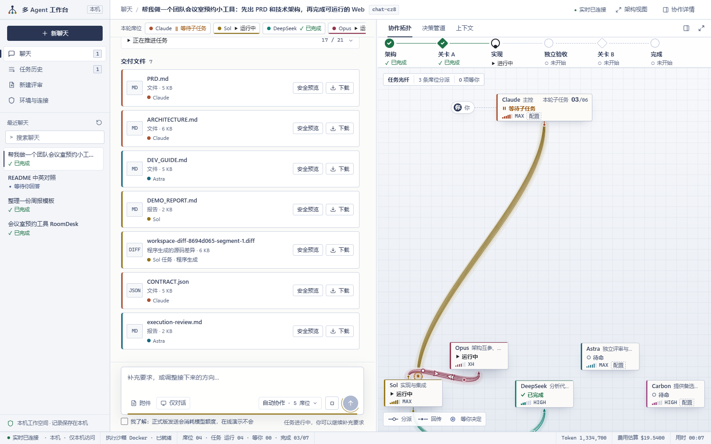
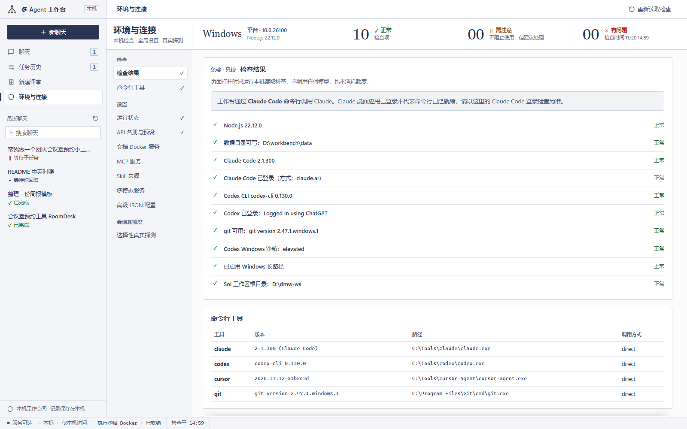
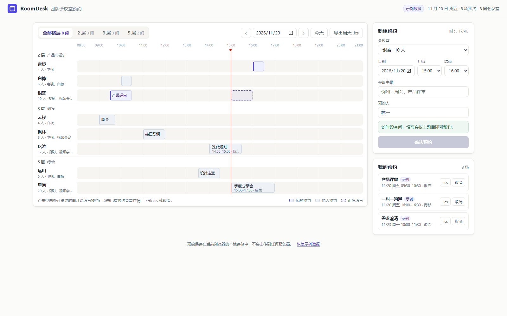
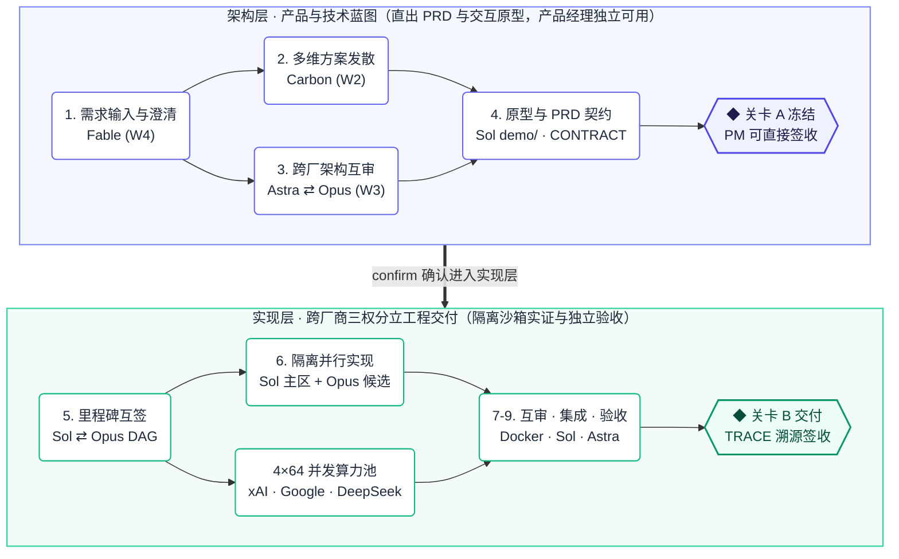

<div align="center">

<picture>
  <source media="(prefers-color-scheme: dark)" srcset="docs/images/apexcluster-logo-dark.svg" />
  <source media="(prefers-color-scheme: light)" srcset="docs/images/apexcluster-logo.svg" />
  
</picture>

# ApexCluster

### 面向复杂软件工程与产品设计的旗舰级跨厂商多 Agent 集群
**支持本地订阅零额外 API 费用 · 模型不齐全按任务自由配队 & 自定义主 Agent · 架构层直出 PRD · 跨厂实证交付**

<p>
  <a href="https://johnson-durui.github.io/ApexCluster/"><strong>▶ 在线演示</strong></a> ·
  <a href="README.md"><strong>中文</strong></a> ·
  <a href="README.en.md">English</a> ·
  <a href="ARCHITECTURE.md">架构设计</a> ·
  <a href="docs/CONFIGURATION.md">配置指南</a> ·
  <a href="docs/EXTENDING.md">扩展开发</a> ·
  <a href="SECURITY.md">安全模型</a>
</p>

<p>
  <a href="https://johnson-durui.github.io/ApexCluster/"></a>
  = 22.12" />
  
  
  
  
  
  
  
</p>

</div>

---

**ApexCluster**（Multi-Agent Workbench）不是又一个让单个大模型自言自语、靠口头输出 `"LGTM / All tests passed"` 糊弄过关的玩具脚本，而是一套**本机运行、程序掌权、跨厂商三权分立的重型多 Agent 产品与软件工程集群**。

它原生编排 **Anthropic · OpenAI · Google · xAI · DeepSeek** 五大前沿厂商模型，内置 **5 个加权旗舰席位（权重 `4 → 3 → 2`）** 与 **4 个高并发 Worker 算力池（每池最高 `64` 并发）**，配合全新 **指挥台（Command Deck）实时观测前端**，同时兼顾**低门槛订阅复用、缺模型灵活配队**与**旗舰级双层工程交付**：

- **本地订阅优先 · 零额外 API 费用防误扣**：双模型评审工作台（`/api/runs`、`npm run probe`）**开箱即用本机已登录的 Claude Code（Claude Pro/Max）与 Codex CLI（ChatGPT Plus/Pro）订阅额度**，零 API Key；启动子进程前自动剥离 `ANTHROPIC_API_KEY` / `OPENAI_API_KEY` / `CODEX_API_KEY` 及全部 `*_API_KEY` 环境变量并探活登录态，杜绝误扣按量 API 账单。指挥台也支持经隔离证明的本地 CLI 聊天模式（`driverMode: "cli"`，含可选 Cursor Agent CLI / Grok），并可随时切换 BYOK API 模式跑通完整 5 厂商流水线。
- **模型不齐全也能玩转多 Agent · 按任务自由配队 & 自定义主 Agent**：无需配齐 5 家厂商——仅有 1 个、2 个或任意子集可用模型即可正常启动（缺失模型清晰标注原因，**绝不静默降级**）。发起任务前在指挥台 **「自定义协作团队」**（或 `POST /api/chats` 的 `team` 字段）中，**自由指定任意可用模型或本地 CLI Agent 作为 `主 Agent`**，按需挑选 `0–16` 位协作者（`通用协作` / `实现写入` / `独立评审`），并显式授予调度权限（`自主调度 proactive` / `按需调度 explicit` / `禁止调度 none`、`allowLeadWrite`、`requireAcceptanceReview`），会话级冻结并由代码强制执行。
- **架构层直出 PRD 与原型（完美适配产品经理任务）**：输入一段原始想法，多厂商席位并行完成需求澄清、方案发散、跨厂可行性互审与交互式 Demo 原型搭建，在 **关卡 A** 输出完整的 **`PRD.md`、技术架构文档、开发指南与可量化验收契约 `CONTRACT.json`**——即使只有单厂商 API（`single-provider` 预设）也可直出全套 PRD 与原型；产品经理既可直接签收交付研发，也可一键继续进入实现层。
- **实现层跨厂制衡与沙箱实证交付**：确认关卡 A 后，异厂席位互签计划、隔离并行编码、跨模型家族复跑冻结检查、独立验收，最终生成可追溯的加密 `TRACE` 与可交付软件产物。

> **核心铁律**：**模型文本无权推进流水线。** 只有程序状态机、`CONTRACT.json` 结构化契约、SHA-256 产物哈希、隔离容器命令回执、跨窗口已读确认与最终 `TRACE`，才能决定交付。

### ⭐ Star 涨势

<p align="center">
  <picture>
    <source media="(prefers-color-scheme: dark)" srcset="docs/images/star-surge-dark.svg" />
    <source media="(prefers-color-scheme: light)" srcset="docs/images/star-surge.svg" />
    
  </picture>
</p>

<p align="center"><sub>首颗 star 之后不到 4 天 0 → 149，单小时峰值 +28 · <a href="https://star-history.com/#Johnson-Durui/ApexCluster&Date">查看实时曲线 →</a></sub></p>

---

## 在线演示

[](https://johnson-durui.github.io/ApexCluster/)

**[▶ 立即打开在线演示 →](https://johnson-durui.github.io/ApexCluster/)** &nbsp;|&nbsp; **[打开演示交付的 RoomDesk 应用 →](https://johnson-durui.github.io/ApexCluster/demo-project/)**

在线演示运行的是本仓库真实的 **Command Deck 指挥台前端**，所有数据来自预设脚本：**无需后端、不需要 API Key、不调用任何模型**。点击底部状态栏里的 **「▶ 播放完整演示」**，即可观看一个团队会议室预约工具（**RoomDesk**）从需求到交付的完整流程：

1. **架构集群产出 PRD 与原型**：多个席位并行完成需求澄清、方案发散与跨厂互评，产出 PRD、架构文档与可运行 Demo，右侧实时任务地图以光纤动画实时呈现每次分派与回传；
2. **关卡 A 人工决策**：系统自动停下并列出本关交付物与契约，等你确认（20 秒无操作自动继续）；
3. **跨厂商实现与独立验收**：异厂席位互签计划、并行实现、交叉评审并由独立席位验收；
4. **关卡 B 交付签收**：PRD、架构文档、源码、测试报告与完整项目包均可安全预览或下载。

演示交付的 [RoomDesk 示例应用](https://johnson-durui.github.io/ApexCluster/demo-project/) 可直接在线试用（支持楼层筛选、冲突检测与 iCal 导出，附 30 个自动化测试）。任务历史、新建评审、环境与连接等页面也全部开放浏览。

在本机启动同一份在线演示：

```sh
npm ci --prefix web
npm --prefix web run dev:demo
```

然后打开 <http://localhost:5180>。演示源码位于 [`web/demo/`](web/demo/)，静态构建命令为 `npm --prefix web run build:demo`（输出至 `web/dist-demo/`）。

---

## 界面实景截图

以下截图均取自本仓库真实前端界面（在线演示预设数据）：

| | |
|---|---|
| <br>**实时任务地图**：主控拆解任务，席位之间的分派与回传以光纤动画实时呈现 | <br>**人工关卡**：需要你决定的地方自动停下，列出本关交付物与契约 |
| <br>**交付物面板**：每份产物标明产出席位，支持安全预览或下载 | <br>**全屏架构视图**：查看协作拓扑、推理强度与上下文用量 |
| <br>**决策管道**：架构 → 关卡 A → 实现 → 独立验收 → 关卡 B → 完成 | <br>**任务历史**：评审运行状态、等待人工项与运行度量 |
| <br>**评审运行**：多候选方案对比与结构化决策 | <br>**环境与连接**：席位型号、密钥状态、执行沙箱与扩展服务 |



<sub>演示流水线最终交付的 RoomDesk 会议室预约应用：按楼层筛选、实时冲突检测与 iCal 日历导出，附带 30 个自动化测试。</sub>

---

## 为什么做 ApexCluster？

大多数多 Agent 框架在面对真实复杂工程时都会迅速失控：上下文一长就遗忘原始需求、同家族模型互相吹捧放水、模型静默降级却不告知、宿主机直接跑命令泄露密钥。ApexCluster 针对每一个工程死穴建立了**代码级硬约束**：

| 维度 | 常见玩具多 Agent 框架 | ApexCluster |
| :--- | :--- | :--- |
| **接入成本与订阅复用** | 强绑多份高价 API Key，或粗暴透传环境变量导致本地 CLI 误扣 API 费用 | **本地订阅 + BYOK 双轨防误扣**：双模型评审开箱即用本机 **Claude Code / Codex CLI** 订阅（零 API Key），子进程前主动剥离全部 `*_API_KEY` 并校验登录态；API 模式支持只核对已有厂商与自定义 OpenAI 兼容端点 |
| **模型弹性与主控编排** | 缺一个模型就整体不可用，或写死单一主控模型、无法按任务调整授权边界 | **缺模型照常协同 · 自由指定主 Agent**：1 个或任意子集模型均可启动；按任务自由指定任意可用模型（API 或本地 CLI）为 **`主 Agent`**，显式授予调度权（`自主` / `按需` / `禁止`）与写/验权限，会话冻结、代码强约束 |
| **评审独立性** | 同一个模型 / 同厂商自写自审，互相打高分 | **强制跨厂商制衡**：实现作者与评审者必须来自不同厂商家族（如 `Sol` [OpenAI] ⇄ `Opus` [Anthropic]），并由 `Astra` 在冻结副本上独立验收 |
| **完成判定** | 靠 LLM 在对话里声称“已完成 / 测试通过” | **实证驱动状态机**：所有阶段流转绑定 `CONTRACT.json`、源码/产物 SHA-256 哈希、结构化 `argv` 命令回执与最终 `TRACE` |
| **模型与镜像诚信** | 静默替换廉价模型、偷降推理强度、拉取 `:latest` | **零静默降级**：精确模型 ID + 零推理开销的账户列表证明（`models:verify`）+ 不可变 `sha256:` Docker 镜像摘要 |
| **超长上下文治理** | 塞满后用 LLM 摘要覆盖上下文，丢失需求与报错 | **无损窗口轮换**：基于真实物理上限与实际用量提前切窗，由程序机械组装保留原始引用的交接包，绝不覆盖用户原文与未送达回执 |
| **并发与权限控制** | 扁平循环、角色越权、任意 agent 改主目录 | **加权委派层级 (`4 → 3 → 2 → 1`)**：只能向严格更低权重派单；仅 `Sol` 拥有主工作区写权与集成权；4 大 Worker 池每池最高 64 并发 |
| **执行与密钥安全** | 宿主机直接拼 shell 字符串执行，环境变量裸奔 | **强边界沙箱**：默认无网络非 root Docker 容器（支持 WSL `bwrap` / Windows MXC）；API Key 仅驻留宿主机环境变量，零透传至前端/日志/容器 |

---

## 双层架构与全链路流水线

> **完美适配产品经理任务（架构层独立可用）**：架构层本身就是一个高规格的**多模型协同 PRD 与原型工作台**。你只需提供原始业务想法或零散需求，集群会自动完成需求澄清、多方向方案对比、跨厂商盲区挑战与交互式 `demo/` 原型验证，在 **关卡 A** 输出结构化的 **`PRD.md` + `ARCHITECTURE.md` + `DEV_GUIDE.md` + `CONTRACT.json`**。对于纯产品规划、需求评审、竞品/方案比选和原型演示等产品经理核心任务，停在关卡 A 即可直接带走全套高质量交付物；需要落地研发时，确认关卡 A 即可无缝进入实现层。



---

## 默认旗舰集群编组（Flagship Roster）

所有席位权限绑定在**席位与阶段**，而非模型名称；开启 `delegationWeight` 后，任何 Agent 只能向**权重严格更低**的目标派单，彻底杜绝权限倒挂。

### 5 大旗舰决策与工程席位

| 席位 | 权重 | 默认旗舰模型 | 厂商家族 | 推理强度 | 核心职责与硬权限边界 |
| :--- | :---: | :--- | :--- | :---: | :--- |
| **`claude` (Lead)** | `4` | `claude-fable-5-2` | Anthropic | `max` | 唯一用户入口、需求澄清、维护唯一共同方案与最终交付；可向全体席位委派，无主区直写权 |
| **`astra` (Secondary)** | `3` | `gpt-6.2-astra` | OpenAI | `max` | 架构可行性审查、风险修正、**跨家族独立验收**（拥有独立验收与沙箱执行权） |
| **`opus` (CrossRef)** | `3` | `claude-opus-5-5` | Anthropic | `max` / `xhigh` | 架构并行互参、实现计划互签、**隔离候选副本实现**与跨厂商代码评审 |
| **`carbon` (Ideator)** | `2` | `gemini-4-carbon` | Google | `high` | 提供多样化架构方案、适用条件与潜在盲区，专注发散、不作裁决 |
| **`sol` (Builder)** | `2` | `gpt-6.2-sol` | OpenAI | `max` | **主工作区唯一写者与集成者**、构建可运行 Demo、真实命令执行与过审候选集成 |

### 4 大高并发 Worker 算力池（Weight `1`）

| 算力池 | 默认模型 | 厂商家族 | 并发上限 | 适用阶段 | 专长任务 |
| :--- | :--- | :--- | :---: | :---: | :--- |
| **`grok`** | `grok-4.7` | xAI | `64` | 架构层 + 实现层 | 高速、工程化的有界子任务与隔离副本编辑 |
| **`hydrogen`** | `gemini-4-hydrogen` | Google | `64` | 架构层 + 实现层 | 大规模并行 worker、超长上下文分析与校验型子任务 |
| **`deepseek`** | `deepseek-v4-pro` | DeepSeek | `64` | 实现层 | 实现层深度代码分析与高性价比有界工程子任务 |
| **`mini`** | 随父席位自适应 (`claude-haiku-5-5` / `gpt-6-luna` / `gemini-4-hydrogen`) | 自适应 | `64` | 架构层 | 随父席位厂商自动匹配的低成本快速子任务 |

> **无需配齐 5 家厂商**：上述旗舰名册是完整上限，而非起步门槛。如果你只有本地订阅、或仅配置了 1–2 个 API 模型，可直接使用下方**本地订阅双轨模式**与**按任务自由配队 & 自定义主 Agent**；只有单家 API 密钥时，也可直接在界面或 CLI 选用 `single-provider` 预设跑通完整架构层至关卡 A。详见 [配置指南](docs/CONFIGURATION.md#rosters-and-presets)。

---

## 本地订阅支持 & 按任务自由配队（缺模型也能用）

### 1. 本地订阅优先 · 零额外 API 费用防误扣矩阵

ApexCluster 严格区分**本地订阅 CLI** 与 **BYOK API Key** 两条执行路径，绝不静默跨模式切换，也不抓取浏览器 Cookie：

| 使用场景 / 子系统 | 鉴权方式 | 支持的模型 / 厂商 | 开箱复用本地订阅（零 API Key） | 实测防误扣与边界说明 |
| :--- | :--- | :--- | :---: | :--- |
| **双模型评审工作台**<br>（`/api/runs` · `npm run probe` · Web「新建评审」） | 本地订阅 CLI | **Claude Code**（Claude Pro/Max）<br>**Codex CLI**（ChatGPT Plus/Pro）<br>可选 **Cursor Agent CLI**（Grok） | **✅ 开箱即用**<br>（Claude Code + Codex CLI） | 启动 CLI 子进程前主动剥离 `ANTHROPIC_API_KEY`、`ANTHROPIC_AUTH_TOKEN`、`OPENAI_API_KEY`、`CODEX_API_KEY`、`CURSOR_API_KEY` 及全部 `*_API_KEY`；`npm run probe` 探查 `claude auth status` 与 `codex login status`，发现 API 计费路径立即告警。Cursor CLI 需额外 H7 能力记录 |
| **指挥台 CLI 聊天模式**<br>（`driverMode: "cli"`） | 本地订阅 CLI | `claude`（Claude Code）、`astra` / `sol`（Codex CLI）、`grok`（Cursor Agent CLI） | **🔒 隔离证明门控**<br>（零 API Key，Fail-Closed） | 支持动态宿主机工具与**按任务自由指定任意已验证 CLI 席位作为主 Agent**（`cliRoster`，不再写死 Claude）；需具备本地能力证明 `capabilities/models.json` 与 Windows Job 隔离监督器（Cursor 聊天另需 WSL2 `bwrap` 隔离） |
| **指挥台 API 聊天模式**<br>（`driverMode: "api"`，默认） | BYOK API Key | Anthropic · OpenAI · Google Gemini · xAI · DeepSeek + 自定义/本地 OpenAI 兼容端点 | 需配置已有厂商 API Key | 支持只核对已拥有的部分厂商（`npm run models:verify -- --provider <p>`）；通过 `config/models.registry.local.json` 可接入 `127.0.0.1` / `localhost` 等 OpenAI 兼容端点；支持按任务自由配队与自定义主 Agent |
| **v1 双层旗舰流水线**<br>（`npm run pipeline` · Web「流水线」） | 仅 BYOK API Key | 同上五大厂商（单厂商 `single-provider` 跑至**关卡 A**；跨厂商跑完整实现与验收） | 仅 API 模式 | **诚实边界**：v1 双层流水线当前强制要求 API 模式；Google Gemini 与 DeepSeek 仅支持 API Key；单会话内不支持 CLI 与 API 混编，也不存在静默降级 |

### 2. 模型不齐全时的按任务自由配队 & 自定义主 Agent 授权调度

没有全部 5 家模型？系统启动**绝不因缺失模型而阻塞**，未配置或未验证的模型会清晰标注不可用原因，你可以按当前手里实际拥有的模型自由组合：

| 你当前拥有的模型资源 | 可直接运行的模式 | 说明（零静默降级） |
| :--- | :--- | :--- |
| **本机已登录 Claude Code / Codex CLI 订阅** | 双模型评审（开箱即用） + CLI 聊天自定义团队（需能力证明） | 零 API Key；CLI 聊天可自由指定 `claude` / `astra` / `sol` / `grok` 任一可用席位为**主 Agent**并调度其他 CLI 席位 |
| **仅 1 个 API 模型**（或单家厂商） | 指挥台自定义团队（单模型开启 `allowLeadWrite`）+ `single-provider` 架构层流水线 | 界面与 CLI 均可选 `single-provider` 跑完完整架构层、在**关卡 A** 产出 `PRD.md` + 架构文档 + Demo（界面明确标注「仅架构阶段 · 至关卡 A」） |
| **任意 2 个及以上可用模型** | 指挥台「自定义协作团队」（自由主 Agent + 多协作者 + 独立评审） | 例如用 `gpt-6.2-astra` 当主 Agent 调度 `gpt-6.2-sol` 编码 + `claude-opus-5-5` 独立评审验收，缺谁都不影响启动 |
| **五大厂商 API 配齐** | 完整 `flagship` 双层工程流水线 + 4×64 并发 Worker 池 | 解锁完整跨厂互审、隔离实现、独立验收与加密 `TRACE` 端到端交付 |

在指挥台发消息前点击输入框旁的 **「自动协作 / 自定义协作团队」** 面板（`CollabPopover`），或直接调用 `POST /api/chats` 传入 `team` 字段，即可按任务完成编排：

- **自由指定主 Agent（`leadModel`）**：在 API 模式任选已核对的注册模型（可选推理强度），或在本地 CLI 模式任选 `claude` / `astra` / `sol` / `grok` 作为**主 Agent**。
- **显式授予调度权限（`delegation`）**：
  - `proactive`（**自主调度**）：授权主 Agent 自主拆解子任务并自由调度所有已授权协作者；
  - `explicit`（**按需调度**）：仅在明确要求或确有必要时委派协作者；
  - `none`（**禁止调度**）：主 Agent 独立执行，不向其他模型派单。
- **精细化读写与验收授权**：支持按任务勾选 `allowLeadWrite`（允许主 Agent 直接写入工作区与执行命令）与 `requireAcceptanceReview`（交付前强制由 `reviewer` 角色独立评审验收）。
- **按需编配 0–16 位协作者（`members`）**：为每位协作者分配职责——`collaborator`（只读分析/发散）、`writer`（主区或隔离副本实现写入与命令执行）、`reviewer`（只读快照独立验收与测试）；不可用模型直接拦截并返回精确原因（HTTP `503`）。
- **会话级冻结与代码强校验（`FrozenChatTeam`）**：任务创建即冻结该会话专属名册（`apiRoster` / `cliRoster`），`agent_submit` 严格绑定已授权的冻结成员，若某冻结成员在会话中途离线则直接拦截并返回 HTTP `503`（绝不静默丢弃；而默认非流水线会话会自动从 `agent_submit` / `worker_submit` / `fanout_submit` 裁剪离线席位与算力池），同时由 `delegationWeight`、`can.delegateSeats` 与 `WorkspaceGateway` 强制执行权限边界。

示例（`POST /api/chats`：仅有 OpenAI + Anthropic 时，自由指定主 Agent 与授权协作者）：

```json
{
  "title": "重构订单结算模块",
  "workspaceId": "w-my-project",
  "team": {
    "leadModel": "gpt-6.2-astra",
    "leadEffort": "max",
    "delegation": "proactive",
    "allowLeadWrite": false,
    "requireAcceptanceReview": true,
    "members": [
      { "model": "gpt-6.2-sol", "role": "writer", "effort": "max" },
      { "model": "claude-opus-5-5", "role": "reviewer", "effort": "max" }
    ]
  }
}
```

---

## 六大核心工程保障

- **零静默降级与可证明模型注册表**：`config/models.registry.json` 严格声明每个模型的精确 ID、协议、物理上下文窗口、支持的推理强度与计费单价。运行 `npm run models:verify` 通过各厂商 listing 接口生成本地证明（**零推理调用、零费用**）；缺失密钥、SDK 版本漂移或推理强度不匹配会直接拦截，绝不偷偷换模型或降级。
- **跨厂商独立性与防“自审”契约**：实现阶段强制要求主实现席与评审席属于不同模型家族；`Astra` 与 `Opus` 在架构集群阶段必须实际读取对方分页意见并回执确认；最终 `TRACE` 在源码采纳后生成，防止文档写入污染已评审源码哈希。
- **无损上下文窗口轮换与事件溯源恢复**：每次调用均为干净模型窗口，运行时追踪真实 Token 消耗并在逼近硬阈值（`softTokens` / `hardTokens` / `hardRatio`）时自动开窗，基于持久化事件流机械组装交接包，完整保留原始需求、契约引用与未送达回执；异常中断仅恢复安全窗口，不盲目重放失败任务。
- **强隔离沙箱与不可变镜像钉死**：所有模型生成的命令均为结构化参数数组（杜绝宿主机 Shell 注入），默认运行在绑定 `sha256:` 本地不可变摘要的非 root Docker 容器中；普通命令彻底断网，依赖安装走独立受控 `installNetwork` 通道与命名缓存卷；同时支持经能力证明的 WSL `bwrap` 与 Windows MXC 执行后端。
- **先预留、后核算的预算硬护栏**：每次发起模型请求前按最保守价格档位预留额度，响应返回后以实际标准化用量结算，配合 `budget.maxUsd` 与 `budget.maxTokens` 防止复杂集群失控烧费。
- **双轨接入（本地订阅防误扣 + API 流水线 + 指挥台按任务配队）**：既开箱兼容本机已登录的 **Claude Code** 与 **Codex CLI** 订阅额度（子进程前剥离全部 `*_API_KEY` 防止误扣），也提供仅监听 `127.0.0.1` 的 React 19 指挥台（支持按任务自定义**主 Agent** 与协作者权限）及无头 JSONL 自动化流水线。

---

## 快速开始

### 1. 零成本体验完整离线 Docker 流水线（推荐第一步）

环境要求：**Node.js >= 22.12**、**Git** 与运行中的 **Docker**。以下命令使用脚本化 Provider（**真实模型调用数为 0，零 API 费用**），但会**真实构建并启动隔离 Docker 容器**、执行实现与验收命令并在结束后自动清理独占资源：

```sh
git clone https://github.com/Johnson-Durui/ApexCluster.git
cd ApexCluster
npm ci
docker build -t dmw-sandbox:local docker/sandbox
npm run demo:offline
```

运行成功时，终端最后一行输出 `PASS`。

---

### 2. 使用本机已有订阅直接开跑（零额外 API 费用：Claude Code / Codex CLI）

如果你已在本机安装并登录了 **Claude Code**（Claude Pro/Max）与 **Codex CLI**（ChatGPT Plus/Pro），**无需任何 API Key** 即可发起跨模型方案/代码评审（子进程启动前自动剥离 `ANTHROPIC_API_KEY` / `OPENAI_API_KEY` / `CODEX_API_KEY` 及全部 `*_API_KEY`，防止误扣按量费用）：

```sh
npm run probe            # 零推理探查本地 CLI 版本、登录态与防误扣状态
npm ci --prefix web
npm run build:web
npm start                # 仅监听 127.0.0.1:5170
```

1. 确认 `npm run probe` 输出的命令发现与订阅登录态正常（如需覆盖二进制路径或模型 ID，可复制 `config/workbench.config.example.json` 为 `config/workbench.config.json`）。
2. 打开 [新建评审](http://127.0.0.1:5170/#/new)，确认本地订阅额度提示后即可发起双模型评审。

> **本地 CLI 聊天模式说明**：若希望指挥台「新聊天」也走本地订阅驱动（含自由指定 `claude` / `astra` / `sol` / `grok` 为主 Agent），需在 `config/chat.config.json` 中设置 `"driverMode": "cli"` 并按 [本地 CLI 模式文档](docs/CONFIGURATION.md#local-cli-mode) 准备隔离与协议能力证明；`npm run pipeline` 始终使用 API 模式。

---

### 3. 启动本机指挥台 Web 工作台 & 按任务自由配队（缺模型也能用）

只需配置你手里已有的部分厂商 API Key（无需配齐 5 家），核对对应厂商清单后即可启动指挥台自由编组：

```sh
# 示例：仅核对你已配置密钥的厂商（零推理调用、零费用）
npm run models:verify -- --provider openai --provider anthropic
npm ci --prefix web
npm run build:web
npm start
```

服务仅绑定回环地址 `127.0.0.1`（默认端口 `5170`，可在 `config/workbench.config.json` 中通过 `port` 修改），后端绝不向前端暴露任何真实密钥值：

1. **按任务自由配队 & 自定义主 Agent**：在新建对话输入框旁点击 **「自动协作」→「自定义协作团队」**，任选可用模型作为 **主 Agent**、勾选 `0–16` 位协作者及职责（`通用协作` / `实现写入` / `独立评审`），设置调度权限（`自主调度` / `按需调度` / `禁止调度`）与读写/验收开关，发消息即锁定该会话专属协作团队（亦可通过 `POST /api/chats` 传入 `team` 字段调用，详见 [配置指南](docs/CONFIGURATION.md#per-task-custom-teams-and-lead-agent-dispatch)）。
2. **单厂商架构层直出 PRD**：如果只配了 OpenAI 密钥，也可在「流水线」模式下直接选择 `single-provider` 预设，跑通完整架构层并在**关卡 A** 产出 PRD、架构文档与原型。

> **注意**：通过 `npm start` 启动时，浏览器端无法直接授权新的产品目录；要针对本地目录执行完整工程流水线，请使用下方 `npm run pipeline` 命令。

---

### 4. 运行真实 API 工程流水线（单厂商架构试用 / 全旗舰跨厂商交付）

#### 第一步：配置密钥与隔离镜像

1. 复制环境变量模板：将 `.env.example` 复制为 `.env`，按需填入已拥有的厂商密钥（`ANTHROPIC_API_KEY`、`OPENAI_API_KEY`、`GEMINI_API_KEY`、`XAI_API_KEY`、`DEEPSEEK_API_KEY`）。
2. 复制运行时配置：将 `config/chat.config.example.json` 复制为 `config/chat.config.json`，按 [Docker 配置指南](docs/CONFIGURATION.md#docker-execution) 填入本地镜像不可变 `sha256:` ID，并在 `budget.maxUsd` 中设置本次预算上限。

#### 第二步：核对可用模型并启动流水线

**方式 A：单厂商快速体验架构阶段（仅需 OpenAI Key）**

```sh
npm run models:verify -- --provider openai
mkdir product
npm run pipeline -- --preset single-provider --requirement tests/fixtures/pipeline/todo-cli/requirement.md --workspace ./product
```

> `single-provider` 预设支持跑完架构集群并停在**关卡 A** 审阅产物（PRD、架构、开发指南、Demo 与契约）。

**方式 B：全旗舰跨厂商端到端交付（架构 + 隔离实现 + 交叉评审 + 独立验收 + TRACE）**

在 `.env` 中配齐旗舰名册所需的五个厂商密钥，完成零费用型号核对后切换至 `--preset flagship`：

```sh
npm run models:verify
npm run pipeline -- --preset flagship --requirement tests/fixtures/pipeline/todo-cli/requirement.md --workspace ./product
```

<details>
<summary><strong>查看 CLI 参数与退出码说明</strong></summary>

**常用参数**

| 参数 | 说明 |
| :--- | :--- |
| `--requirement <file>` | UTF-8 需求文件路径（必填） |
| `--workspace <directory>` | 已存在的目标产品目录（必填；程序经本地目录选择授权后才可读写） |
| `--preset <name>` | 名册预设，默认为 `flagship`（可选 `single-provider` 或自定义名册） |
| `--auto` | 自动通过澄清与关卡 A/B；不传时在交互终端接受 `confirm`、`revise` 或 `cancel` |

**输出与退出码**

命令输出逐行 JSON（NDJSON），适合脚本与 CI 集成：
- `0`：流水线顺利完成
- `2`：参数或路径无效
- `3`：用户取消，或非交互终端遇到需要人工决策的关卡
- `4`：运行失败或检测到停滞
- `5`：启动配置、模型证明或执行后端不可用

</details>

---

## 仓库结构与质量验证

```text
├── src/
│   ├── providers/   # Anthropic Messages / OpenAI Responses / Google GenAI 统一适配与 ScriptedProvider
│   ├── chat/        # 持久化对话运行时、加权调度器、窗口轮换、权限与工作区授权、工具边界
│   ├── pipeline/    # 架构集群、关卡 A/B、契约校验、里程碑 DAG、跨厂商互审、集成、独立验收与 TRACE
│   ├── exec/        # Docker 不可变沙箱、WSL bwrap、Windows MXC 与命令回执封装
│   └── server/      # 仅监听 127.0.0.1 的本地 API 与实时事件流
├── web/
│   ├── src/         # React 19 + TypeScript + Vite 指挥台（Command Deck）工作台前端
│   └── demo/        # 零后端静态在线演示与自动化浏览器验收脚本
├── config/          # 精确模型注册表、旗舰/单厂商名册预设与运行时配置模板
├── docker/sandbox/  # 离线隔离执行容器构建定义
├── tests/           # 200+ 自动化测试套件（后端 + 前端，零真实 API 调用的确定性协议夹具）
└── docs/            # 配置、扩展、安全文档与界面演示素材
```

运行全量本地质量与发布前安全扫描：

```sh
npm run check            # TypeScript 类型检查 + 完整后端测试套件
npm ci --prefix web
npm --prefix web test    # 前端测试
npm run build:web        # 前端生产构建
npm run prepublish:scan  # 敏感信息 / 个人路径 / 密钥泄露扫描
```

---

## 深入文档

- [ARCHITECTURE.md](ARCHITECTURE.md) — 双层流水线机制、上下文轮换与信任边界详解
- [docs/CONFIGURATION.md](docs/CONFIGURATION.md) — 模型注册表、加权名册、按任务自定义主 Agent 与团队、预算护栏、Docker 镜像钉死与本地订阅 CLI 模式
- [docs/EXTENDING.md](docs/EXTENDING.md) — 接入新模型、新 Provider、新席位、自定义工具与执行后端
- [SECURITY.md](SECURITY.md) — 安全模型、操作者职责、Live Smoke 防护与依赖审计说明
- [CHANGELOG.md](CHANGELOG.md) — 版本变更记录
- [README.en.md](README.en.md) — English Documentation

## 许可证

基于 [MIT](LICENSE) 协议开源。
